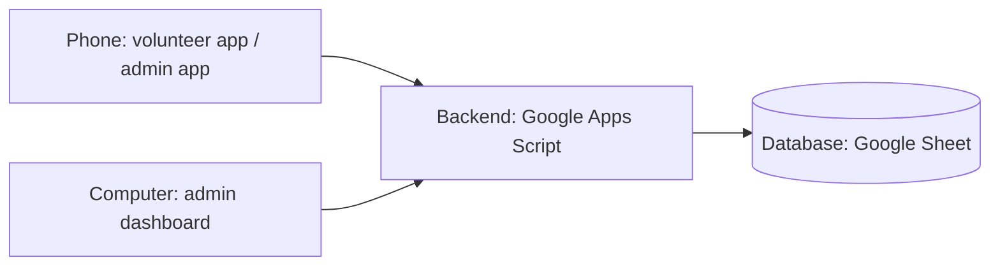

# MINDS Volunteer Management: Version 1 report

NTU Tech for Good (Semester 1, AY2026/27) · Prepared for MINDS · October 2026

This report explains what Version 1 does, how to demo it, and how it works
behind the scenes. Every person and record shown in the demo is fictional.

**Contents**

1. [Product](#1-product)
2. [Demo guide](#2-demo-guide)
3. [Technical notes](#3-technical-notes)
4. [Status, limits and next steps](#4-status-limits-and-next-steps)

---

## 1. Product

### 1.1 Overview: one system, three ways in

Version 1 replaces paper attendance and manual logging of volunteer hours. It has
**one shared database (a Google Sheet)** and **three ways to use it**:

| | **Volunteer app** | **Admin app** | **Admin dashboard** |
| --- | --- | --- | --- |
| **Who** | Volunteers | Volunteer leaders / MINDS staff | Volunteer leaders / MINDS staff |
| **Device** | Phone (works on a computer too) | Phone (works on a computer too) | Computer (laptop or desktop) |
| **Used for** | Booking sessions, showing the QR pass, giving feedback | Running sessions **on the day**: confirm bookings, pair trainees, scan QR passes | **Record keeping at a desk**: people, hours, fundraising, outings, trips, house visits |
| **How to open** | The website link | Same link, sign in with a leader account | Same link + `admin/` |

**The split, in one sentence:** the *app* is for what happens on the day, and the
*dashboard* is for everything that touches the records.

- **The volunteer app and admin app are the same app.** It shows different screens
  depending on who signs in. A leader can switch to "volunteer mode" to book
  sessions for themselves.
- **The dashboard is a separate page** made for a big screen (side menu, wide tables,
  filters, exports). It uses the same leader accounts.
- **Everything is saved to one Google Sheet.** A volunteer added on the dashboard can
  sign in on their phone a minute later. Every QR scan shows up in the dashboard's
  hours report straight away. Staff can also open the Sheet itself to read or filter
  the data.

**Other things worth knowing**

| Feature | What it means for MINDS |
| --- | --- |
| **Fits any screen** | The app is designed for phones, but works on tablets and computers. The dashboard is designed for laptops and desktops, and adjusts to smaller windows. |
| **Installable** | Volunteers can add the app to their phone's home screen like a normal app. No App Store or Play Store needed. |
| **Works with poor signal** | QR passes are saved on the volunteer's phone. Leaders can keep scanning without signal, and the scans upload when the signal returns. |
| **Privacy** | Volunteers only see what they need about their trainee (e.g. communication style, things to take note). Medical, dietary and caregiver details are for leaders and staff only. |
| **Nothing is deleted** | People are deactivated, trainees marked inactive, products taken off sale, outings or trips cancelled. History is never lost. |
| **Uses MINDS's existing trainee list** | The system reads MINDS's trainee tab by its column names. It never reorders or deletes rows, and never touches columns it doesn't know. |
| **Dark mode** | The 🌗 button switches between light and dark. |

### 1.2 Volunteer app

| # | Feature | What the volunteer can do |
| --- | --- | --- |
| 1 | **Register** | Sign up with name, birthday, email, phone, Telegram and an emergency contact, and agree to the data notice. |
| 2 | **Volunteer Guide** | Read a short guide (projects, what to wear, what MINDS expects) before the first booking. |
| 3 | **Find and book sessions** | See upcoming sessions and book one. Search forgives typos ("carnval" finds "Sports carnival helpers"). A booking shows **Pending** until a leader confirms it. |
| 4 | **Cancel a booking** | Cancel an upcoming booking from the Home screen. |
| 5 | **Meet your trainee** | Once confirmed, see the paired trainee's profile and notes from earlier volunteers. |
| 6 | **QR pass** | Show a QR code to clock in at the start and clock out at the end. It works without signal. |
| 7 | **Feedback** | After a session, rate it (1–5), leave comments, and write an observation about the trainee for the next volunteer. |
| 8 | **Hours and history** | See total hours, number of sessions and a list of past sessions under **Me**. |
| 9 | **My details** | Edit own details and change password. |

### 1.3 Admin app (phone, for leaders)

| # | Feature | What the leader can do |
| --- | --- | --- |
| 1 | **Post sessions** | Create a session: title, date, times, venue (pick or add new), project, number of places, notes, and which trainees are attending. |
| 2 | **Confirm bookings** | Confirm one booking or **Confirm all & pair trainees** at once. |
| 3 | **Automatic pairing** | When a booking is confirmed, a trainee is paired automatically: the same trainee as last time if free, otherwise the one with the fewest pairings. Leaders can change any pairing. |
| 4 | **Scan QR passes** | Scan with the phone camera. First scan = clock in, next = clock out. Handles walk-ins and scans without signal. |
| 5 | **Clock in by hand** | For a volunteer whose phone is flat. |
| 6 | **Review notes** | Volunteer observations stay private until a leader shares them (they can edit first) or keeps them private. |
| 7 | **People** | Search volunteers and trainees. Edit details, change roles, reset passwords, deactivate. |
| 8 | **Content** | Edit the Volunteer Guide, projects and venue list. |
| 9 | **Switch mode** | Switch to volunteer mode to book sessions for themselves. |
| 10 | **Link to dashboard** | **Me → Leader tools → Staff dashboard**. |

### 1.4 Admin dashboard (computer)

The menu has five sections.

| Section | Page | What staff can do |
| --- | --- | --- |
| **1. Overview & people** | **Overview** | Key numbers (active volunteers and trainees, hours this month, sessions, unpaid orders, house visits), what needs attention, and upcoming sessions, outings and trips. |
| | **Attendance** | See every clock-in/out for a date range. **Fix** a missed scan-out, or **Add by hand** someone who was never scanned. Hours are worked out again, and the record shows who edited it. |
| | **Volunteer hours** | Hours per volunteer for any date range (this month, this year, all time). **Export** as a spreadsheet file for certificates and reports. |
| | **Volunteers** | **Add a volunteer** (with a temporary password to hand them, or list-only). Edit details, make someone a leader, reset passwords, deactivate. |
| | **Trainees** | **Add and edit trainees**, including medical, dietary and caregiver details. Each trainee's page shows notes for volunteers, house visits, recent sessions, outings and trips. |
| **2. Fundraising** | **Fundraisers** | Create fundraisers and products with prices. **Take orders** with several items; the total is worked out automatically from the prices. Mark orders paid and collected. See total and paid sales. |
| **3. Outings** | **Outings** | Plan outings. Assign each trainee to a volunteer, with group and bus. On the day, **tick each trainee as they board** and watch the count (e.g. 12 / 15). |
| **4. Overseas trips** | **Trips** | Plan trips. Register trainees; their medical and dietary notes are copied for the trip. Assign volunteers, confirm or withdraw. Keep a **to-do checklist** and record **expenses** with a running total. |
| **5. House visits** | **Visit records** | Record visits (family, daily living, social, health, follow-up). History is add-only and newest first. Filter by trainee. |

---

## 2. Demo guide

*For the team. Follow this to show each part working, in about 15 minutes.*

### 2.1 Before the demo

1. Install **Node.js 20 or later** (nodejs.org).
2. In a terminal:

   ```bash
   cd T4G-Sem12627-MINDS-APP/volunteer-app
   npm run dev
   ```

3. Open these in the browser:

   | What | Link |
   | --- | --- |
   | App (volunteer + admin) | http://localhost:5173 |
   | Admin dashboard | http://localhost:5173/admin/ |
   | The "Google Sheet" (see every change) | http://localhost:5173/__sheet |

4. Demo accounts:

   | Role | Email | Password |
   | --- | --- | --- |
   | Leader (admin) | `leader@example.com` | `LeaderDemo123` |
   | Volunteer (Vera) | `volunteer@example.com` | `VolunteerDemo123` |
   | Volunteer (Sam) | `sam@example.com` | `VolunteerDemo123` |

**Tips**

- Use a **normal window for the volunteer** and a **private/incognito window for the
  leader**, so both can be signed in side by side. (The app and dashboard share a
  sign-in within one window.)
- To show the **phone layout** on a computer: press F12 (Mac: Cmd+Option+I), then click
  the phone icon.
- Demo data **resets** every time the server is restarted (Ctrl+C, then `npm run dev`).
  Restart before each demo for a clean start.
- The demo starts with: sessions today and coming up, Vera paired with Alex today,
  Sam's booking waiting to be confirmed, one volunteer note waiting for review, a bake
  sale, a zoo outing, a Bangkok trip and two house visits.

### 2.2 Volunteer app (normal window, phone view)

| Step | Do this | Point out |
| --- | --- | --- |
| 1 | On the sign-in page, tap **Register now** and fill in fictional details | Everything a volunteer gives MINDS, including an emergency contact |
| 2 | Read the guide, tap **I've read the guide** | New volunteers must read it before booking |
| 3 | **Sessions** → type "bakng" in search → **Book** | Search forgives typos; the booking shows **Pending** |
| 4 | Sign out, sign in as **Vera** (`volunteer@example.com`) | |
| 5 | **Home** → today's Art & Craft session | Her trainee Alex's profile, "things to take note" and notes from earlier volunteers |
| 6 | **QR pass** | The code the leader scans; it works offline |
| 7 | **Me** | Hours volunteered and session history |

### 2.3 Admin app (private window, phone view)

| Step | Do this | Point out |
| --- | --- | --- |
| 1 | Sign in as the **leader** | Leader screens: Sessions · Scan · People · Me |
| 2 | Open **Art & Craft** (today) → **Confirm all & pair trainees** | Sam is confirmed and paired automatically; the message says why |
| 3 | On Vera's row → **Clock in by hand** | Show the new row in `/__sheet` → **Attendance** |
| 4 | **Sessions** → **New session** → type a new venue → **+ Add a new venue** | Sessions and venues are created in seconds |
| 5 | Tap the blue **notes to review** bar → **Share with future volunteers** | Volunteer notes are checked by a leader before others see them |
| 6 | **People** → Vera → edit her phone | Leaders can edit anyone's details |
| 7 | **Scan** (optional) | The camera opens. Real scanning is best shown on the live site with two phones |
| 8 | **Me → Leader tools** | Guide, venues and the **Staff dashboard** link |

### 2.4 Admin dashboard (private window, full screen)

| Step | Section | Do this | Point out |
| --- | --- | --- | --- |
| 1 | Overview | Sign in as the leader | Key numbers and what's coming up, from the same data as the app |
| 2 | Attendance | **Fix** a record → change the times → **Save** | Hours recalculate; "Edited by" is recorded |
| 3 | Volunteer hours | **This year** → **Export totals (CSV)** | Opens in Excel or Google Sheets, ready for certificates |
| 4 | Volunteers | **Add volunteer** (keep "Create a login" ticked) | A temporary password appears. Sign in with it in the volunteer window to prove it works |
| 5 | Trainees | **Add trainee** → fill dietary notes → open **Alex** | One page per trainee: details, notes, visits, sessions, outings, trips |
| 6 | Fundraising | Open **Charity bake sale** → **Take an order** → set quantities | The total is worked out automatically; mark it **Paid** and watch sales update |
| 7 | Outings | Open **Zoo outing** → tick a trainee as **Boarded** | The count updates (e.g. 1 / 3); filter by group or bus |
| 8 | Overseas trips | Open **Bangkok** → tick a checklist item → **Add expense** | Medical and dietary notes copied per trip; running total of spending |
| 9 | House visits | **Record a visit** | Newest first; can't be edited later, so the history stays true |
| 10 | Volunteer window | Sign in as a volunteer and open `/admin/` | Shows "Leaders only" |

---

## 3. Technical notes

### 3.1 The pieces at a glance



| Piece | What it is | Where it lives in the code |
| --- | --- | --- |
| **App** (volunteer + admin) | A website built with plain HTML and JavaScript, styled with Tailwind CSS | `volunteer-app/web/` |
| **Dashboard** | Same technology, reusing the app's building blocks | `volunteer-app/web/admin/` |
| **Backend** | Google Apps Script: small programs that run on Google's servers | `volunteer-app/gas/` |
| **Database** | One Google Sheet | Owned by MINDS |
| **Hosting of the website** | GitHub Pages (free website hosting from GitHub) | Published automatically |

There are **no paid services and no extra servers** to run.

### 3.2 Database: Google Sheets

- **Why Google Sheets?** MINDS already keeps its data in Google Sheets. Staff can open,
  read, filter and fix data without any new software, and it is free.
- **How it is used:** each tab is like a table and each row is one record. The app finds
  columns by the **header text in row 1**, so column order doesn't matter and MINDS's
  own extra columns are left alone.
- **Tabs used:**

  | Group | Tabs |
  | --- | --- |
  | People | Volunteers, _Auth (hidden: scrambled passwords), Trainees (MINDS's existing list) |
  | Sessions and hours | Sessions, Bookings, Attendance |
  | Feedback and notes | Feedback, Trainee Notes |
  | Content | Venues, Projects, Volunteer Guide |
  | Fundraising | Fundraisers, Products, Orders, Order Items |
  | Outings | Outings, Outing Assignments |
  | Overseas trips | Trips, Trip Participants, Trip Logistics, Trip Expenses |
  | House visits | House Visits |

- **Setting up:** a one-click `setup()` step creates any missing tabs and columns. It
  never deletes or overwrites data and is safe to run again.
- **Demo copy:** a fully filled fictional version is at
  `volunteer-app/docs/demo-data/MINDS-Volunteer-Demo-Data.xlsx` (import into Google
  Sheets to test).

### 3.3 Backend: main points

- **One backend for everything.** The app and dashboard send requests (e.g. "book this
  session", "take this order") to the same Apps Script backend, which reads and writes
  the Sheet.
- **Every request is checked on the server**, not just in the browser:
  - **Sign-in:** each request carries a signed "ticket" from signing in, valid for 30 days.
    Deactivating someone or changing their role takes effect immediately.
  - **Roles:** dashboard and leader actions are refused for volunteers.
  - **Input checks:** required fields, valid dates, times, phone numbers, sensible
    amounts and limits on text length. Bad input gets a clear message.
- **Passwords** are never stored as plain text. They are scrambled ("hashed") with a
  secret key, so someone who opens the Sheet cannot see them. Five wrong tries in
  15 minutes temporarily blocks that email.
- **QR passes** are signed with the same secret key, so they can't be forged, and each
  one only works on its own day.
- **Two people saving at once** is handled by a lock: changes are made one at a time,
  so two leaders scanning at the same moment can't overwrite each other.
- **Money** is added up in whole cents and order totals always come from the stored
  prices, so totals are exact and can't be typed in wrongly.
- **Safe display:** anything people type is shown as plain text, so it can't break the
  page. Text that looks like a spreadsheet formula is stored as plain text.
- **Tested:** 56 automated tests run the real backend code against a pretend Sheet. They
  run automatically on GitHub for every change.

### 3.4 Moving to the real Google Sheet and going live

Today, everything runs on a laptop with demo data. The code does **not** need to change
to go live: only the connections do. The full step-by-step guide is in
`volunteer-app/README.md` (Part 3).

**Two environments, set up in this order:**

| Environment | Uses | For |
| --- | --- | --- |
| **Test ("Exp")** | A **copy** of the Sheet with fictional data | Trying it with real phones and real QR scanning |
| **Live ("Prod")** | The **real MINDS Sheet** | Real volunteers, after MINDS signs off |

**Steps to go live (do them for Test first, then repeat for Live):**

| # | Step | Who | What happens |
| --- | --- | --- | --- |
| 1 | **Prepare the Sheet** | MINDS / team | Make a test copy (or import the demo file). Check the trainee tab's column names match. |
| 2 | **Create the backend** | Team | In the Sheet: Extensions → Apps Script. Paste in the files from `volunteer-app/gas/` (or upload them with a tool called clasp). |
| 3 | **Connect it to the Sheet** | Team | Add the Sheet's ID in Apps Script's settings ("script properties"). IDs are kept there, never in the public code. |
| 4 | **Run `setup()`** | Team | Creates all tabs and columns and the secret key. Back up the real Sheet first. |
| 5 | **Deploy the backend** | Team | Deploy → Web app. Google gives a web address ending in `/exec`. This is the "server", hosted by Google for free. |
| 6 | **Publish the website** | Team | Put the `/exec` address into the GitHub settings and run the publish step. GitHub Pages hosts the app and dashboard at one web address (dashboard = address + `admin/`). |
| 7 | **Create the first leader** | MINDS | Register in the app, then run `makeFirstAdmin()` once. That leader promotes others in the app. |
| 8 | **Test with real phones** | Everyone | One phone shows a QR pass, a leader's phone scans it, and the row appears in the Sheet. |
| 9 | **Automatic updates (optional)** | Team | With a few GitHub settings, every approved code change updates the backend and website by itself. |

**Before the live launch, MINDS should:**

- [ ] Own the Apps Script project with a **MINDS Google account** (not a student's).
- [ ] **Back up** the real Sheet (File → Make a copy).
- [ ] Agree which trainee details volunteers may see (**PDPA**). This is one setting in
      `gas/Config.gs`.
- [ ] Review the settings in `gas/Config.gs` (e.g. automatic pairing, leader review of
      notes, guide before first booking).
- [ ] Review the known limits in section 4.

**If MINDS later wants a "real" database** (e.g. for many thousands of users):

- The website (app and dashboard) can stay as it is. Only the backend address changes.
- The backend would be rewritten for a hosted server and database (for example a small
  Node.js server with PostgreSQL on a cloud host). The actions and rules are already
  clearly defined and covered by the 56 tests, which can be reused as a checklist.
- Data moves across by exporting each Sheet tab, since every tab is a plain table with
  IDs linking the records.
- This adds monthly hosting costs and someone to maintain the server, so it is only
  worth it if Google Sheets becomes too slow (see section 4).

---

## 4. Status, limits and next steps

### Status

| Area | Status |
| --- | --- |
| Volunteer app | ✅ Done and tested on the demo |
| Admin app | ✅ Done and tested on the demo |
| Admin dashboard | ✅ Done and tested on the demo (automated browser walkthrough of every section) |
| Automated tests | ✅ 56 / 56 passing |
| Connected to Google | ⏳ Not yet. Next stage (section 3.4) |
| Tested on real phones with QR scanning | ⏳ Not yet. Needs the Google connection |

### Known limits of Version 1

- **Speed:** Google Apps Script takes about 1–2 seconds per action and handles about
  30 at the same moment. Fine for session-sized groups; not for thousands of users at once.
- **Passwords** use the strongest scrambling Apps Script offers, which is weaker than a
  dedicated server would use. Emails are not verified.
- **No deleting** of records (by design). Orders can't be edited after they're taken,
  only marked paid or collected.
- **Pairing** doesn't yet consider gender, skills or preferences; leaders adjust it.
- **Long lists** load all at once: fine for hundreds of records, would need paging for
  many thousands.
- **One sign-in per browser** is shared between the app and the dashboard.
- **The QR scanner library** is no longer actively updated (it still works and is
  stored for offline use).

### Suggested next steps

1. Connect to a **test Google Sheet** and try everything with real phones (section 3.4).
2. A **walkthrough with MINDS staff** to collect feedback on the dashboard.
3. Agree the **PDPA** rules for what volunteers see.
4. Possible Version 2 ideas: Telegram reminders before sessions, pairing by gender or
   interests, charts on the dashboard overview.

---

*More detail:* `volunteer-app/README.md` (setup and reference),
`volunteer-app/docs/USER-GUIDE.md` (how to use each screen),
`volunteer-app/DESIGN-NOTES.md` (why it is built this way), `PROGRESS.md` (work log).
