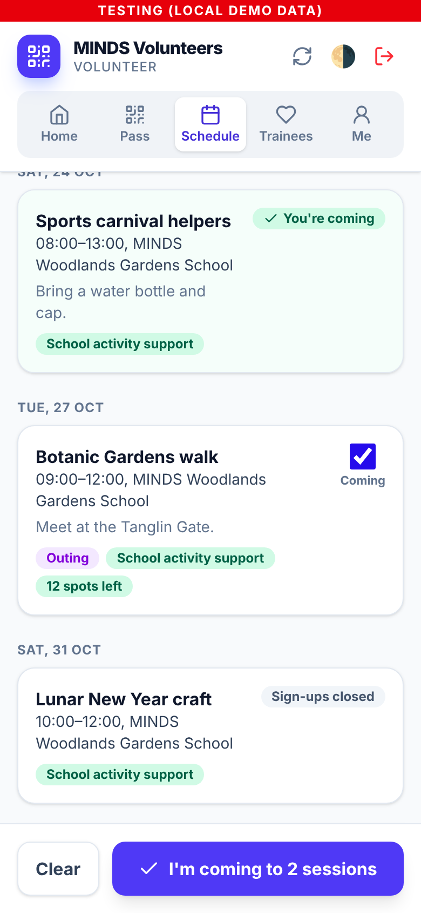
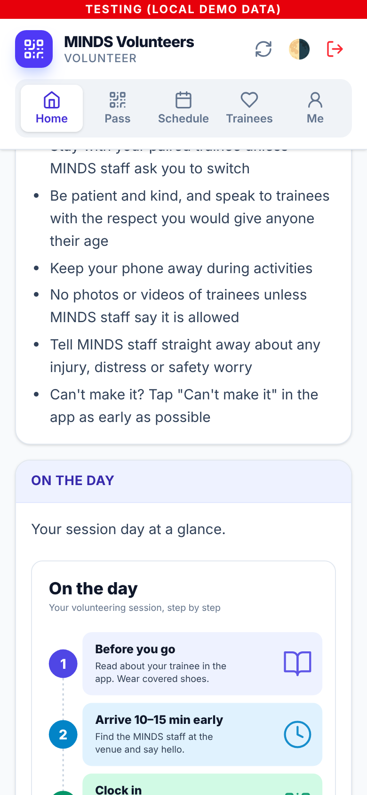
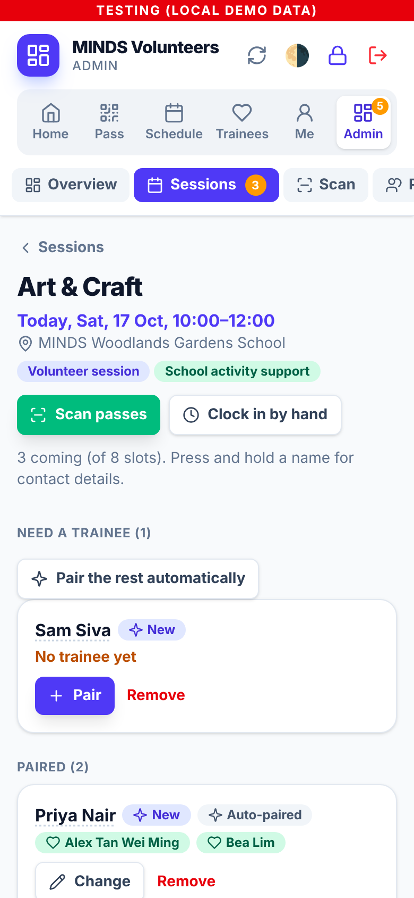
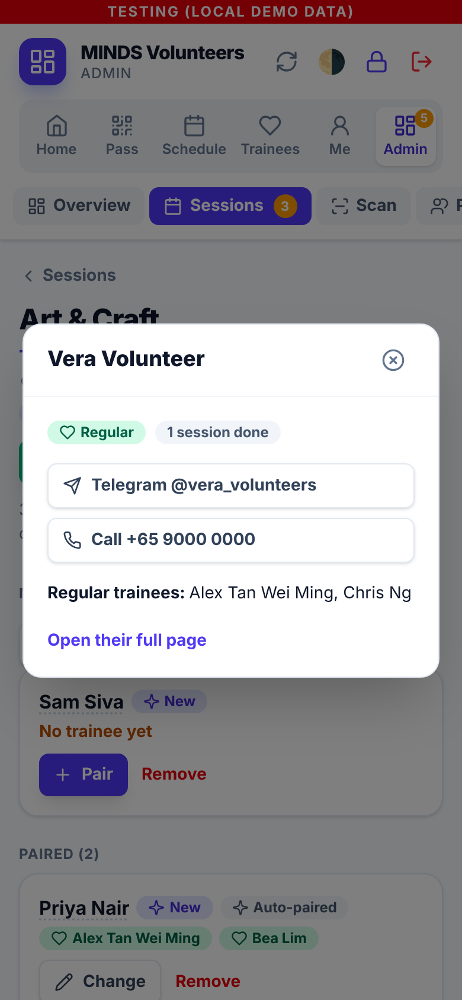
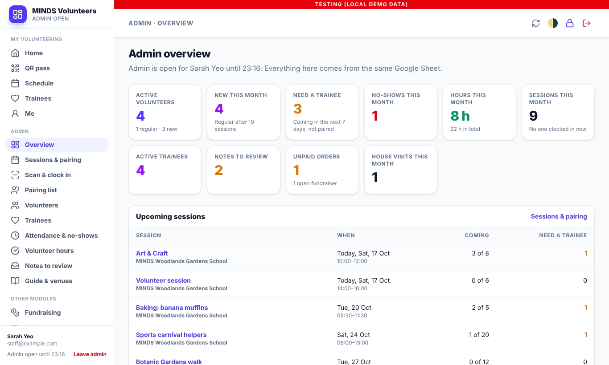
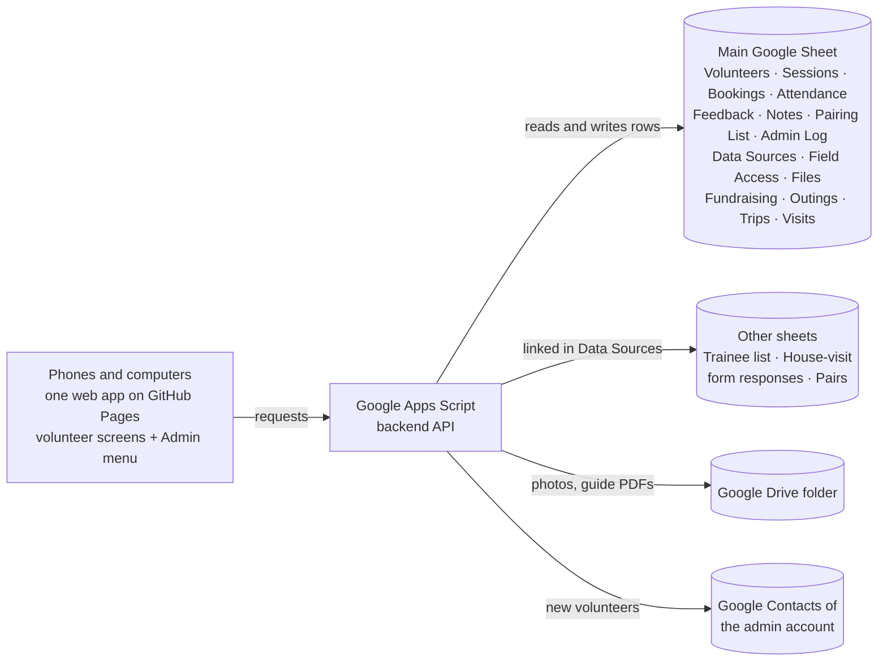

# MINDS Volunteer App

An app for **MINDS** volunteering, built for NTU Tech for Good (Semester 1, AY2026/27).
It replaces paper attendance and manual hour logging. Volunteers say which sessions they're
coming to and show a QR pass; MINDS staff scan it to clock them in and out, and the hours
are recorded in a Google Sheet straight away.

**One app for everyone.** Volunteers and MINDS staff use the same app with their own
accounts. Staff open the **Admin** menu with one shared MINDS admin password: sessions and
pairing, scanning, volunteers and trainees, attendance and hours, the pairing list,
fundraising, outings, overseas trips, house visits and settings. Every admin change is
logged with the name of the person who made it. The same pages adapt from a phone to a
desktop screen.

<table>
  <tr>
    <td></td>
    <td></td>
    <td></td>
    <td></td>
    <td></td>
  </tr>
  <tr>
    <td align="center"><sub>"I'm coming" to several sessions</sub></td>
    <td align="center"><sub>Trainee info (regular)</sub></td>
    <td align="center"><sub>Guide infographic</sub></td>
    <td align="center"><sub>Admin: pairing</sub></td>
    <td align="center"><sub>Press and hold for details</sub></td>
  </tr>
</table>



<sub>Screenshots use the local demo; every person in them is fictional.</sub>

**Status:** working prototype. It runs fully on a laptop with demo data. Connecting it to
Google Apps Script and a real Google Sheet is the next stage (see
[Part 3](#part-3-integrating-google-apps-script--google-sheets)). What changed after the
partner meeting in October 2026 is listed in
[docs/PARTNER-FEEDBACK-OCT-2026.md](docs/PARTNER-FEEDBACK-OCT-2026.md).

| Part | What it covers |
| --- | --- |
| [Part 1: App features](#part-1-app-features) | What volunteers and MINDS staff (Admin) can do today |
| [Part 2: Test environment](#part-2-setting-up-the-test-environment) | Run the tests and the local demo on your own computer |
| [Part 3: Apps Script & Google Sheets](#part-3-integrating-google-apps-script--google-sheets) | How to connect the app to Google, from test sheet to production |
| [Part 4: Reference](#part-4-reference) | Sheet tabs, repo layout, team workflow, troubleshooting, limits |

The repo also contains **Prototype 1**, an earlier offline staff app. See
[docs/prototype-1/README.md](../docs/prototype-1/README.md). The [repository README](../README.md)
gives an overview of both apps.

---

## Part 1: App features

### For volunteers (everyone)

| Feature | What it does |
| --- | --- |
| **1. Register and profile** | Sign up with name, birthday, email, phone and **Telegram** (no emergency contact). Edit details later under **Me**. Each new volunteer is added to MINDS's Google Contacts. |
| **2. Volunteer Guide** | New volunteers read a short guide (projects, what to wear, expectations, and an **"On the day" infographic**) before their first session. Sections can show a picture or a PDF. |
| **3. Schedule and "I'm coming"** | Every volunteer sees every upcoming session (screenshot or **Share** it for caregivers). Tick several sessions and tap **I'm coming**: no confirmation step. Forgiving search ("carnval" finds "Sports carnival helpers"). |
| **4. Who I'm with** | The trainee(s) a volunteer is paired with, with a photo. **Regular** volunteers can read about every trainee (an info dump); **new** volunteers only see their own trainee. Admins choose which fields each group sees. |
| **5. Trainee updates** | After a visit, volunteers update a trainee's answers (written to MINDS's house-visit form responses with their name) and/or send a note for admins to review. |
| **6. QR pass** | Show a QR code to clock in and out. Passes are stored on the phone, so they work without signal. |
| **7. Feedback** | Rate the session and leave an observation for the next volunteer paired with that trainee. |
| **8. New → regular** | A volunteer becomes regular automatically after 10 completed sessions (admins can also set it). |

### For MINDS staff: the Admin menu

Admin opens with the **shared MINDS admin password** (not tied to anyone's account), from
**Me → Admin** on a phone or **Open admin** in the menu on a computer. It stays open on that
device for 12 hours; every admin change goes into the **Activity log** (and the "Admin Log"
tab) with the person's name.

| Section | What staff can do |
| --- | --- |
| **Overview** | New and regular volunteers, who still needs a trainee this week, no-shows, hours, sessions, notes to review, unpaid orders, upcoming sessions, outings and trips. On a phone it starts with a menu of every section. |
| **Sessions & pairing** | Add sessions (**Type**: Volunteer session or Outing; title optional; venue dropdown; trainees attending). The session page is for pairing only: **Need a trainee** first (new and ad-hoc volunteers), multi-pairing both ways (one trainee with several volunteers, one volunteer with several trainees), **Pair the rest automatically**. Contact details appear on **press and hold** of a name. |
| **Scan & clock in** | **Scan QR passes** (walk-ins, offline scans), and **Clock in by hand** as a separate tab. |
| **Pairing list** | Regular volunteer ↔ trainee pairs (many-to-many). Regular pairs are used first whenever the volunteer says they're coming. Import from an existing pairs sheet or from the house-visit responses. |
| **Volunteers** | New/regular, no-shows, **Deactivate / Reactivate** on the list itself (needs the admin password again), edit details, reset passwords, regular trainees and every trainee they have been with. |
| **Trainees** | Details (each field shows who sees it), photo, house-visit answers, regular volunteers, **everyone they have been with**, notes, sessions, outings, trips. |
| **Attendance & no-shows** | Fix missed scans, add attendance by hand, **no-shows per volunteer** and missed sessions. **Volunteer hours** with CSV export. |
| **Notes to review** | Volunteers' observations (from session feedback and trainee updates) before they become trainee notes. |
| **Guide & venues** | Edit the guide (text, a picture or a PDF per section), projects and venues. |
| **Other modules** | **Fundraising**, **Outings**, **Overseas trips** and **House visits**, working as before (House visits also shows the linked form responses). |
| **Settings** | Change the admin password, sign out every other admin device, **Databases** (links to other Google Sheets or one tab of them, and the Drive folder for photos), **what new and regular volunteers see**, Google Contacts sync. |

Records are never deleted from Admin: people are deactivated, trainees marked inactive,
pairs ended (kept as history), products taken off sale, and outings or trips cancelled.

### Behind the scenes

- **Every action is written to a Google Sheet.** Hours, sign-ups, feedback, notes, pairs
  and the admin log are rows that staff can read, filter and correct directly.
- **Works with MINDS's existing sheets.** The trainee list and the house-visit form
  responses are read by header names, from the main spreadsheet or from other
  spreadsheets linked in **Settings → Databases**. Admins can add and edit trainees; the
  app only writes the columns it knows and never deletes or reorders rows.
- **Privacy:** volunteers only see the trainee fields admins allow for their group
  (new or regular). Photos are kept private in Google Drive and only handed to people who
  may see them. Nothing is shown to someone who isn't signed in.
- **Installable** on a phone home screen as a web app (PWA). No app store needed.

Step-by-step guides for each task are in
[docs/USER-GUIDE.md](docs/USER-GUIDE.md), and the reasons
behind the design are in [DESIGN-NOTES.md](DESIGN-NOTES.md).

### How it fits together



| Layer | Technology | Where it lives |
| --- | --- | --- |
| Web app (volunteers and Admin) | HTML, vanilla JavaScript, Tailwind CSS | `volunteer-app/web/` (Admin pages in `web/js/admin/`), published to GitHub Pages |
| Backend API | Google Apps Script | `volunteer-app/gas/`, pasted or pushed into an Apps Script project |
| Database | Google Sheets (+ Drive for files) | Sheets owned by MINDS |
| Deployment | GitHub Actions + clasp | `.github/workflows/` |

The web page is hosted on GitHub Pages rather than Apps Script because pages served by
Apps Script can no longer get camera permission, which the QR scanner needs.

---

## Part 2: Setting up the test environment

The test environment runs **the real backend code** against a pretend spreadsheet held
in memory. You don't need a Google account, internet access or real data.

### Step 1: Install the tools (once)

| Tool | Check with | Needed | Get it |
| --- | --- | --- | --- |
| Git | `git --version` | any version | Mac: `xcode-select --install`. Windows: [git-scm.com](https://git-scm.com) |
| Node.js | `node -v` | **20 or later** | [nodejs.org](https://nodejs.org) (LTS installer) |

Mac: use **Terminal** (Cmd+Space, then type "Terminal"). Windows: use **PowerShell** or
**Git Bash**.

### Step 2: Get the code

```bash
cd ~
git clone https://github.com/vcoder302026/T4G-Sem12627-MINDS-APP.git
cd T4G-Sem12627-MINDS-APP/volunteer-app
```

There's nothing to `npm install`, because the volunteer app has no dependencies. Run every
`npm` command in this README from the `volunteer-app` folder.

> **Paths with spaces:** if a folder is named like `T4G-Sem12627-MINDS-APP 2`, put the path in
> quotes: `cd "/Users/you/Downloads/T4G-Sem12627-MINDS-APP 2/volunteer-app"`. You can also type
> `cd ` with a space and drag the folder from Finder into Terminal.

### Step 3: Run the automated tests

```bash
npm test
```

Expected result: `ℹ tests 83`, `ℹ pass 83`, `ℹ fail 0`. `tests/gas.test.js` covers the
main flow: register, read the guide, say "I'm coming", pairing (regular pairs,
multi-pairing, new vs regular), the shared admin password and the admin log, scanning,
no-shows, feedback and trainee notes. `tests/dashboard.test.js` covers the admin records:
attendance fixes and hours reports, adding volunteers and trainees, order totals, outings,
trips and house visits. `tests/partner.test.js` covers the October 2026 partner feedback:
database links, the house-visit responses as trainee updates, what new and regular
volunteers see, importing pairs, partner history, photos, guide PDFs and Google Contacts.
They also run automatically on every pull request.

### Step 4: Start the local demo

```bash
npm run dev
```

You should see:

```
MINDS Volunteer app (local mock) → http://localhost:5173
  MINDS staff:       staff@example.com / StaffDemo123  (then Me → Admin, password AdminDemo123)
  Regular volunteer: volunteer@example.com / VolunteerDemo123
  New volunteer:     sam@example.com / VolunteerDemo123
  Sheet view:    http://localhost:5173/__sheet
  Contacts view: http://localhost:5173/__contacts  (simulated Google Contacts of vcoder302026@gmail.com)
```

Open **<http://localhost:5173>** and sign in with a demo account:

| Who | Email | Password |
| --- | --- | --- |
| Sarah Yeo, MINDS staff (open **Me → Admin** with admin password `AdminDemo123`) | `staff@example.com` | `StaffDemo123` |
| Vera, a regular volunteer (regular pairs: Alex and Chris) | `volunteer@example.com` | `VolunteerDemo123` |
| Sam, a new volunteer (waits for an admin to pair him) | `sam@example.com` | `VolunteerDemo123` |
| Priya, 9 sessions done (her 10th, today, makes her a regular); one no-show | `priya@example.com` | `VolunteerDemo123` |

The demo also has a separate "house-visit form responses" spreadsheet linked under
**Admin → Settings → Databases**, the Pairing List imported from it, photos of the
(fictional, drawn) trainees, a fundraiser, an outing, an overseas trip and house visits.

Open **<http://localhost:5173/__sheet>** in another tab to see what the app would write to
Google Sheets (both spreadsheets), and **<http://localhost:5173/__contacts>** for the Google
Contacts it would create. Refresh them after each action. The old dashboard address,
`/admin/`, now opens the Admin menu in the app.

- To **stop** the demo, press **Ctrl+C**. All demo data resets when it stops.
- To use **another port**, run `PORT=5174 npm run dev`.

### Step 5: Walk through the main flow

Use a normal browser window for a volunteer and a private or incognito window for MINDS
staff, so you can be signed in as both at once.

| # | As | Do this | Check that |
| --- | --- | --- | --- |
| 1 | New user | Register with fictional details (Telegram is required) | You read the Volunteer Guide (with the "On the day" infographic) first; a contact appears in `/__contacts` |
| 2 | New volunteer | **Schedule** → tick two sessions → **I'm coming to 2 sessions** | Both show "You're coming"; nothing waits for a confirmation |
| 3 | Staff | **Me → Admin** → type a wrong password, then `AdminDemo123` | The wrong try and the opening appear in **Activity log** |
| 4 | Staff | **Sessions & pairing** → today's Art & Craft | Sam and the new volunteer are under **Need a trainee**; Vera (regular) is already with Alex and Chris |
| 5 | Staff | **Press and hold** Vera's name | Her Telegram and phone appear (no emergency contact) |
| 6 | Staff | **Pair** Sam with a trainee; pair the new volunteer with a trainee someone else already has | The message says the trainee is also with that person (multi-pairing) |
| 7 | Volunteer | **Home** and **Trainees** | The trainee shows, with only the fields new volunteers may see |
| 8 | Staff | **Scan & clock in → Clock in by hand** → clock Priya in and out | The message says she is now a regular volunteer |
| 9 | Regular (Vera) | **Trainees** → Alex → **Add an update** → change Observations | A new row appears in the house-visit responses in `/__sheet`, with her name |
| 10 | Staff | **Settings → What volunteers see** → tick a field for new volunteers | New volunteers see it; the change is in the Activity log |
| 11 | Staff | **Volunteers** → **Deactivate** on a row → admin password | They can't sign in until reactivated |
| 12 | Staff | **Attendance & no-shows** | Priya's missed session yesterday is listed as a no-show |
| 13 | Staff | **Pairing list** → **By trainee**; **Trainees** → Alex | Regular pairs both ways; Alex's page lists everyone he has been with |
| 14 | Staff | Fundraising, Outings, Overseas trips, House visits | They work as before |

The same pages work on a computer: the menu moves to the left (from 1024 px wide) and
tables become wider; on a phone the admin sections are a row of chips and tables turn into
cards.

### Step 6: Check the phone layout

- **Chrome:** press Cmd+Option+I (Windows: F12), then click the phone icon.
- **Safari:** choose **Develop → Enter Responsive Design Mode**. If there's no Develop
  menu, turn it on in Settings → Advanced.
- **Real phone:** connect it to the same Wi-Fi as your computer. Find your computer's IP
  address (Mac: `ipconfig getifaddr en0`; Windows: `ipconfig`) and open
  `http://<IP>:5173` on the phone.

The **camera scanner only works on HTTPS**, so real QR scanning is tested on the live site
once Google is connected (Part 3, Stage 6).

---

## Part 3: Integrating Google Apps Script & Google Sheets

This is the path from the local demo to a live app backed by Google. The backend code in
`volunteer-app/gas/` is the same code the tests run, so no code changes are needed. You
only connect it to Google.

### The three environments

| Environment | Backend | Data | Banner in the app | Use it for |
| --- | --- | --- | --- | --- |
| **Local demo** | `npm run dev` | In memory, fictional | Red "Testing (local demo data)" | Development and quick testing (Part 2) |
| **Exp** | Apps Script project #1 | A **test copy** of the sheet, fictional data | Purple "Experimentation" | Testing with real phones and QR scanning |
| **Prod** | Apps Script project #2 | The real MINDS sheet | None | Real volunteers, after sign-off |

Always set up **Exp first** and only move to Prod once Exp has been tested end to end.

### What you'll need

- A Google account that will **own** the Apps Script project. For Prod, this should be a
  MINDS-owned account, not a student's personal account.
- Edit access to the Google Sheet.
- Admin access to this GitHub repo, to set variables and secrets.

### Stage 1: Prepare the Google Sheet

1. For Exp, create a **new Google Sheet** or make a copy of the MINDS sheet and replace every
   real person with fictional data.
2. Add a tab named **`Trainees`**, or use the existing trainee tab. The app finds columns by
   **header text in row 1**, so column order doesn't matter. The default headers are:

   | Header | Required? | Shown to volunteers? (starting values; admins change them in Settings) |
   | --- | --- | --- |
   | `Name` | **Yes** | The name, to volunteers paired with them (and to regulars) |
   | `Preferred Name`, `Gender`, `Communication`, `Behaviours`, `Things to Take Note`, `Interests`, `Support Needs` | No | Yes, to new (paired) and regular volunteers |
   | `Medical Notes`, `Dietary Notes` | No | Regular volunteers only |
   | `Caregiver Name`, `Caregiver Phone` | No | Admins only |
   | `Active` | No | "No" keeps a trainee out of automatic pairing |
   | `Trainee ID` | No | Filled in automatically by `setup()` |

3. If MINDS's headers are worded differently, change the **right-hand side** of
   `TRAINEES.columns` in [`gas/Config.gs`](gas/Config.gs) to match.
   For example, `communication: 'Comms Style'`.
4. You don't need to create any other tabs. `setup()` does that in Stage 4.
5. If MINDS keeps the trainee list, the house-visit form responses or a list of pairs in
   **other** spreadsheets, leave them where they are: after Stage 7, link each one in
   **Admin → Settings → Databases**. The house-visit responses are read by header name
   (`Trainee's Full Name`, `Date of Visit`, `Name of Attached Volunteer (1) - …`); every other
   column is treated as trainee information. Change `TRAINEE_UPDATES` in `Config.gs` if
   the form's headers differ.

### Stage 2: Create the Apps Script project

**Option A: copy and paste (simplest)**

1. In the sheet, open **Extensions → Apps Script**.
2. For each file in [`gas/`](gas), create a script file with the
   same name (**+ → Script**) and paste in its contents: `Admin`, `AdminAccess`, `Attendance`,
   `Auth`, `Config`, `Contacts`, `Content`, `Dashboard`, `DataSources`, `Db`, `Files`,
   `Fundraising`, `Main`, `Outings`, `Pairs`, `Profile`, `Setup`, `TraineeUpdates`, `Trainees`,
   `Trips`, `Util`, `Visits`, `Volunteer`.
   Delete the default `Code.gs`.
3. In **Project Settings** (the gear icon), tick **Show "appsscript.json" manifest file in
   editor**. Then replace that file's contents with
   [`gas/appsscript.json`](gas/appsscript.json).

**Option B: clasp (recommended once you update code often)**

```bash
cd volunteer-app                    # from the repository root
npm run clasp:login                 # sign in with the Google account that owns the script
cp .clasp.json.example .clasp.json  # then paste your Script ID into .clasp.json
npm run gas:push                    # uploads everything in gas/
```

You can find the Script ID under Apps Script → Project Settings → IDs. `.clasp.json` and
`.clasprc.json` are in `.gitignore`. **Never commit them.**

### Stage 3: Set the script properties

In Apps Script, go to **Project Settings → Script properties → Add script property**:

| Property | Value | Required? |
| --- | --- | --- |
| `SPREADSHEET_ID` | The long ID in the sheet's URL, between `/d/` and `/edit` | **Yes** |
| `TRAINEE_SPREADSHEET_ID` | ID of a separate file, only if trainees live elsewhere (or link it later in **Admin → Settings → Databases**) | No |
| `NEW_ADMIN_PASSWORD` | The shared MINDS admin password you want, added in Stage 7 | Later |

Sheet IDs are kept here rather than in the code, so they never end up on GitHub. Links to
other sheets (a separate volunteer list, the trainee list, the house-visit form
responses, a pairs sheet) and the Drive folder for photos are set in the app, under
**Admin → Settings → Databases** (stored in the "Data Sources" tab).

**Turn on the People API** (for Google Contacts): in the Apps Script editor, click **+**
next to **Services**, choose **People API**, and **Add** (identifier `People`). The
`appsscript.json` from this repo already lists it.

### Stage 4: Run `checkConfig()` and then `setup()`

1. In the Apps Script editor, open `Setup.gs`, choose **`checkConfig`** in the function
   dropdown, and click **Run**. Approve the permission prompt. The app asks for access to
   spreadsheets, Google Drive (photos and guide files) and Google Contacts (to add new
   volunteers to this account's contacts).
2. Read the **Execution log** at the bottom of the editor. It lists what `setup()` would add,
   without changing anything.
3. Run **`setup()`**. It:
   - creates the app's tabs (Data Sources, Volunteers, Sessions, Bookings, Attendance,
     Feedback, Trainee Notes, Venues, Projects, Volunteer Guide, Pairing List, Admin Log,
     Trainee Field Access, Files, Trainee Photos, and the hidden `_Auth`) and the other
     modules' tabs (Fundraisers, Products, Orders, Order Items, Outings, Outing
     Assignments, Trips, Trip Participants, Trip Logistics, Trip Expenses, House Visits);
   - adds any missing columns to existing tabs (for example Volunteer Type and Google
     Contact on Volunteers);
   - gives every trainee a Trainee ID;
   - adds a starter venue, guide (with the "On the day" infographic), project, and the
     starting "what volunteers see" settings;
   - creates the `APP_SECRET` property, which signs logins and QR passes. **Never share or
     delete it.**

   It never deletes or overwrites data, and it's safe to run again. **Run it again after
   every code update.**

### Stage 5: Deploy the backend as a web app

1. Click **Deploy → New deployment**, then click the gear icon and choose **Web app**.
2. Set **Execute as: Me** and **Who has access: Anyone**.
3. Click **Deploy** and copy the **Web app URL**. It ends in `/exec`.
4. Also note the **Deployment ID**. You'll need it in Stage 8.

**Anyone** is required because the phone app calls the backend directly. The backend does
its own sign-in checks on every request.

### Stage 6: Connect the phone app (GitHub Pages)

1. In GitHub, go to **Settings → Pages → Source** and choose **GitHub Actions** (once).
2. Go to **Settings → Secrets and variables → Actions → Variables** and add:

   | Variable | Value |
   | --- | --- |
   | `APP_ENVIRONMENT` | `Exp` |
   | `GAS_EXP_URL` | The `/exec` URL from Stage 5 |

3. Go to **Actions → Volunteer app · deploy web → Run workflow**. After that, it runs by
   itself whenever `volunteer-app/web/` changes on `main`.
4. Open the site. The link is under Settings → Pages and looks like
   `https://vcoder302026.github.io/T4G-Sem12627-MINDS-APP/`. Admin is inside the app
   (**Me → Admin**); old links ending in `admin/` redirect there.

The URL is added to `web/js/config.js` during deployment, so it's never committed to the repo.

### Stage 7: Set the shared admin password

1. Add the script property **`NEW_ADMIN_PASSWORD`** with the admin password MINDS wants
   (at least 10 characters).
2. Run **`setAdminPassword()`** (in `AdminAccess.gs`). It stores only a salted hash and
   **deletes** `NEW_ADMIN_PASSWORD`, so the password is not left in the settings.
3. Register your own account on the live site, then **Me → Admin** and type the password.

To change it later, use **Admin → Settings → Admin password** (or repeat steps 1–2 if it is
forgotten). Changing it ends admin access on every other device.

**Now test on real phones:** one phone shows a volunteer's QR pass and a staff phone (with
Admin open) scans it. Check that the row appears in the **Attendance** tab, and that new
volunteers appear in the deploying account's Google Contacts.

### Stage 8: Automatic backend deploys (optional)

Without this, every backend code change means pasting files again (or running `npm run gas:push`) and then
**Deploy → Manage deployments → ✏️ → Version: New version**. Otherwise, the live URL keeps
serving the old code.

To have GitHub do it on every merge to `main`, add these repository **Secrets** (Settings →
Secrets and variables → Actions → Secrets):

| Secret | Where to get it |
| --- | --- |
| `CLASPRC_JSON` | Contents of `~/.clasprc.json` after `npm run clasp:login` |
| `GAS_SCRIPT_ID` | Apps Script → Project Settings → Script ID |
| `GAS_DEPLOYMENT_ID` | Deploy → Manage deployments → the web app's Deployment ID |

The workflow runs the tests, pushes the code, and updates the **existing** deployment, so
the `/exec` URL never changes and phones keep working. Without the secrets, it still runs
the tests and skips the deploy. Remember to run `setup()` again after updates that add
columns.

### Stage 9: Test rounds on Exp (deploy, test, fix, redeploy)

Once Exp works, improve the app in **rounds** until MINDS is happy:

```text
snapshot → deploy → users test and give feedback → pause → fix → next round
```

Every round runs on the **Exp** sheet, never on the real MINDS sheet. Each step can be
undone without changing the `/exec` URL, so phones keep working between rounds.

**The switches you use:**

| You want to | Do this | Undo it |
| --- | --- | --- |
| Keep a safe copy of the data | In the Exp sheet: **File → Make a copy**, named e.g. `MINDS-Exp-backup-r1-2026-10-20` | — |
| Go back to the old data | Script properties: set `SPREADSHEET_ID` to the backup copy's ID | Set it back to the previous ID |
| Go back to the old backend code | **Deploy → Manage deployments → ✏️ → Version:** pick the previous version **→ Deploy** | Pick the newer version again |
| Go back to the old website | Revert the commit on `main` (or re-run the web deploy from the previous tag) | Revert the revert |

Notes:

- The backup copy includes every tab, including the hidden `_Auth`, so logins keep
  working after a switch. `APP_SECRET` lives in script properties, not in the sheet, so it
  doesn't change.
- If the script was created from the sheet (Extensions → Apps Script), the copy also gets
  its own copy of the script. Ignore it and never deploy from it.
- Switching to a backup loses anything entered after that backup was made. Write down
  what testers did since then.
- `setup()` only ever adds tabs and columns, and the backend finds columns by their
  header. So older backend code still works on a sheet that newer code has set up, and
  rolling back the code is safe.

**Each round:**

1. **Freeze.** Merge the round's fixes into `main` and tag it: `git tag test-r1 && git push
   origin test-r1`.
2. **Snapshot.** Make a dated copy of the Exp sheet (see the table above).
3. **Deploy.** Publish a new version of the existing deployment (or let Stage 8 do it), run
   the web deploy, then run `setup()`.
4. **Test and collect feedback.** Agree a test window (e.g. 3–5 days) and use one
   feedback place, such as a Google Form or a "Tester feedback" tab with: round, page,
   what happened, what you expected, how serious.
5. **Pause.** At the end of the window, tell testers to stop and export the feedback.
   Decide what to fix.
6. **Fix locally.** Work on a branch against the local demo (`npm run dev`) and `npm test`.
   Add a test for each bug found. **Don't merge into `main` during a test window:** with
   Stage 8 set up, a merge redeploys the backend in the middle of the round.
7. **Choose the data for the next round.** If it's fine, keep it. If the round damaged
   it, switch `SPREADSHEET_ID` to the snapshot. Then start the next round at step 1.

**If something breaks during a round** (data lost, wrong rows written, nobody can sign
in): tell testers to stop, roll back the backend version, switch to the snapshot if the
data was damaged, and only then look for the cause.

**Keep a round log** (one row per round), so there's a record of every release:

| Round | Git tag | Apps Script version | Snapshot | Test dates | Result | Fixed |
| --- | --- | --- | --- | --- | --- | --- |
| 1 (example) | `test-r1` | 4 | `MINDS-Exp-backup-r1-2026-10-20` | 20–24 Oct | Kept data | Booking time zone, CSV header |

**Not built yet** (planned helpers to make rounds quicker): a `snapshot()` function that
makes the dated copy in one click, and a `MAINTENANCE_MODE` script property that makes
the backend refuse changes (read-only) during the pause. Until then, use the manual steps
above and pause by telling testers to stop.

### Stage 10: Going to production (future)

Only start this after the Exp test rounds (Stage 9) are finished and MINDS has agreed.

1. **Create a separate Apps Script project** on the real MINDS sheet (repeat Stages 2–5).
   Script properties belong to each project, so Exp and Prod never share data or secrets.
2. Add the repository variables `GAS_PROD_URL` (the Prod `/exec` URL) and change
   `APP_ENVIRONMENT` to `Prod`. Then run the web deploy workflow again.
3. The automatic backend deploy (Stage 8) targets one project. Point its secrets at the
   project you want to update, or keep Prod updates manual.

**Production checklist:**

- [ ] The Apps Script project is owned by a MINDS account, not a student account.
- [ ] Back up the real sheet (File → Make a copy) before the first `setup()`.
- [ ] Review **Admin → Settings → What volunteers see** with MINDS (new and regular
      volunteers). Volunteers should see only what they need, in line with PDPA.
- [ ] Review the switches in `Config.gs` (for example `REGULAR_AFTER_SESSIONS`,
      `AUTO_PAIR_REGULARS`, `ALLOW_SHARED_TRAINEE`, `AUTO_SHARE_OBSERVATIONS`,
      `REQUIRE_GUIDE_BEFORE_BOOKING`, `SYNC_GOOGLE_CONTACTS`).
- [ ] Deploy from the MINDS Google account whose Contacts should receive new volunteers.
- [ ] Review the known limits: password hashing uses HMAC-SHA256 because Apps Script has no
      bcrypt, emails aren't verified, and Apps Script handles about 30 requests at once.
      See [Limits of this prototype](#limits-of-this-prototype).
- [ ] Set the admin password with `setAdminPassword()`; share it only with MINDS staff.

### Key settings in `Config.gs`

| Setting | Default | What it does |
| --- | --- | --- |
| `TRAINEES.columns` | MINDS-style headers | Your trainee tab's header names |
| `TRAINEES.volunteerVisible`, `regularAlsoVisible` | see the file | **Starting** values for what new / regular volunteers see (then managed in Admin → Settings) |
| `TRAINEE_UPDATES` | the house-visit form's headers | Which columns of the form responses identify the visit; every other column is trainee information |
| `REGULAR_AFTER_SESSIONS` | `10` | Completed sessions before a volunteer becomes regular automatically |
| `AUTO_PAIR_REGULARS` / `AUTO_PAIR_NEW` | `true` / `false` | Who is paired automatically when they say they're coming (regular pairs always apply) |
| `ALLOW_SHARED_TRAINEE` | `true` | Admins may pair one trainee with more than one volunteer in a session |
| `ADMIN_SESSION_HOURS` | `12` | How long Admin stays open on a device |
| `REQUIRE_TELEGRAM` | `true` | Telegram handle required at registration |
| `SYNC_GOOGLE_CONTACTS`, `CONTACT_GROUP` | `true`, `MINDS Volunteers` | Add new volunteers to the deploying account's Google Contacts, under this label |
| `SESSION_TYPES` | Volunteer session, Outing | The session Type choices |
| `AUTO_SHARE_OBSERVATIONS` | `false` | Share volunteer notes without an admin's review |
| `REQUIRE_GUIDE_BEFORE_BOOKING` | `true` | New volunteers read the guide before their first session |
| `DEFAULT_VENUES` | MINDS Woodlands Gardens School | Venues `setup()` adds when the Venues tab is empty |

---

## Part 4: Reference

### What's in the sheet

| Tab | One row per | Notes |
| --- | --- | --- |
| Data Sources | database | Links to other sheets (or one tab, `#gid=`) and the Drive folder; blank = default. Edited in Admin → Settings |
| Volunteers | person | Profile, Telegram, Volunteer Type (blank = automatic, `Regular`, `New`), Regular Since, Status (`inactive` blocks sign-in), Google Contact. Can live in another spreadsheet (Data Sources) |
| _Auth (hidden) | person | Salted password hashes. Never shown in the app |
| Sessions | session | Type, venue, project, trainees attending; status `open` / `closed` / `cancelled` |
| Bookings | "I'm coming" | `confirmed` (coming) or `cancelled`; trainee and More Trainees; walk-in flag |
| Attendance | clock record | Clock in, clock out, hours, who scanned, method (`QR`, `QR (offline)`, `Manual`, `Dashboard`), who edited it |
| Feedback | submission | Session feedback or trainee update; rating, comments, observation, review status |
| Trainee Notes | note | What future volunteers see; `shared` or `hidden` |
| Pairing List | pair | Regular volunteer ↔ trainee pairs; `active` or `ended` (history) |
| Admin Log | admin change | Time, person, action, details. Never contains passwords |
| Trainee Field Access | field | What new and regular volunteers see (Yes/blank) |
| Files, Trainee Photos | file / photo | Photos and guide pictures/PDFs kept privately in Drive |
| Venues, Projects, Volunteer Guide | item | Editable in Admin |
| Trainees (existing) | trainee | The app adds Trainee ID and two observation columns. Admins add and edit trainees, writing only the mapped columns |
| House-visit form responses (linked, separate sheet) | visit | Read by header name; volunteers' updates are added as new rows |
| Fundraisers, Products | fundraiser / product | Prices in SGD; products are archived rather than deleted |
| Orders, Order Items | order / line | Total worked out by the server; each line keeps the price it was sold at |
| Outings, Outing Assignments | outing / trainee | One row per trainee per outing, with volunteer, group, bus and boarded |
| Trips, Trip Participants, Trip Logistics, Trip Expenses | trip / trainee / item / expense | Participants keep their own copy of medical and dietary notes |
| House Visits | visit | Visits recorded in the app; add-only history |

Staff can still edit the sheet directly, but the dashboard is safer: it checks every value
and keeps hours, totals and names consistent. The app re-reads the sheet on every request.
Only rename a header together with `Config.gs`.

A fictional copy of the sheet is in
[`docs/demo-data/MINDS-Volunteer-Demo-Data.xlsx`](docs/demo-data/MINDS-Volunteer-Demo-Data.xlsx).
Import it into Google Sheets (File → Import → Replace spreadsheet) to test Part 3 without
real data. It was made before the October 2026 changes: `setup()` adds the new tabs and
columns, and its old Role and emergency-contact columns are simply ignored.

### Repository layout

```
volunteer-app/
  gas/              Apps Script backend (goes into the Apps Script project)
  web/              the app (published to GitHub Pages)
  web/js/admin/     the Admin pages (same app)
  web/admin/        redirects old dashboard links into the app
  dev/              local demo server, in-memory Google Sheets/Drive/Contacts stand-ins, demo photos
  tests/            backend tests (npm test)
  docs/             user guide, screenshots and the demo spreadsheet
  README.md         this file
  DESIGN-NOTES.md   why it's built this way
.github/workflows/  deploy web (GitHub Pages) and backend (clasp)
docs/prototype-1/   Prototype 1 README and usage guide
server/ public/ tests/  Prototype 1 code (Node.js 24: npm install && npm test && npm start)
PROGRESS.md         progress log
```

### Team workflow

1. Create a branch: `git checkout -b my-change`.
2. Make your change and run `cd volunteer-app && npm test`.
3. Push and open a pull request into `main`. The tests run automatically.
4. Merging to `main` publishes the web app, and the backend too if Stage 8 is set up.

Use **fictional data only** in code, tests and screenshots. Never commit `.clasp.json`,
`.clasprc.json`, Sheet IDs or `/exec` URLs. Use script properties and repository
variables instead.

### Troubleshooting

| What you see | Fix |
| --- | --- |
| `cd: no such file or directory` | The folder isn't where you typed. Find it with `find ~ -maxdepth 4 -type d -name volunteer-app` and use quotes if the path has spaces. |
| `npm error enoent Could not read package.json` | You're in the wrong folder. Run `pwd`, then `cd` into `volunteer-app`. |
| `node: command not found` | Install Node.js LTS from nodejs.org, then open a new Terminal window. |
| `EADDRINUSE` (port in use) | The demo is already running elsewhere. Press Ctrl+C there, or run `PORT=5174 npm run dev`. |
| Demo data disappeared | Expected. The local demo resets when stopped. |
| Live site: "Couldn't reach the server" | Check that `GAS_EXP_URL` ends in `/exec`, web app access is **Anyone**, and you reran the web deploy. |
| `SPREADSHEET_ID is not set` or "tab was not found" | Add the script property and run `setup()`. |
| Code change isn't live | Publish a **New version** of the existing deployment, or set up Stage 8. |
| Camera doesn't start | Use the HTTPS GitHub Pages site and allow camera access in the browser. |
| "The admin password has not been set up yet" | Add `NEW_ADMIN_PASSWORD` and run `setAdminPassword()` (Stage 7). |
| Admin closes by itself | It lasts 12 hours on a device, and ends everywhere when the admin password changes. Type it again. |
| New volunteers don't appear in Google Contacts | Turn on the People API service (Stage 3) and check the Google Contact column for the error; then Admin → Settings → **Sync now**. |
| A Databases link is refused | Share that sheet with the account that runs the app, and open the right tab before copying the link. |

How each screen works for volunteers and staff: [docs/USER-GUIDE.md](docs/USER-GUIDE.md).

### Limits of this prototype

- Passwords (and the shared admin password) use iterated HMAC-SHA256 with a secret pepper
  (Apps Script has no bcrypt or scrypt). Review before a real launch.
- One shared admin password: anyone who knows it can open Admin. The Activity log records
  who (by their own sign-in) did what, but the log tab itself can be edited by people with
  edit access to the sheet.
- Emails aren't verified. Someone registering with an email already on the Volunteers
  list links to that row (it never gives admin access).
- House-visit responses are matched to trainees by full name (spacing and capital letters
  don't matter). Two trainees with the same name would be mixed up.
- Apps Script requests take 1–2 s and handle about 30 at once: fine for session-sized
  groups, not for thousands of simultaneous users. Photos and PDFs are sent through the
  API (up to 5 MB; photos are shrunk on the phone first).
- Pairing doesn't consider gender, skills or preferences beyond regular pairs; admins
  adjust it.
- Admin never deletes records (deactivate, archive, end or cancel instead), and an order
  can't be changed after it's taken (only paid and collected).
- Admin pages load whole lists at once. That's fine for MINDS-sized data (hundreds of
  rows) but would need paging for many thousands.
- The scanner library (`html5-qrcode` 2.3.8) is no longer actively maintained; it loads
  from a CDN with a fallback and is cached for offline use.
- Agree with MINDS which trainee fields new and regular volunteers may see (PDPA).
- Still to discuss with MINDS in person: the "edit session" form, whether sessions and
  outings should become one list, and keeping overseas trip attendance fully separate.
