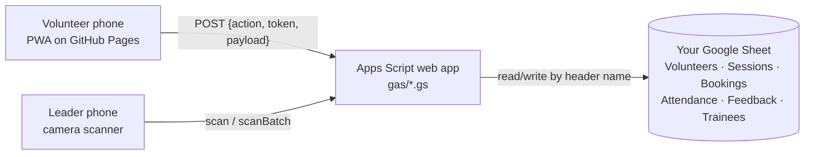

# MINDS Volunteer App

A phone-first web app (PWA) for MINDS volunteering: volunteers register, book
sessions, see their assigned trainee, show a QR pass to clock in and out, and
give feedback. Volunteer leaders post sessions, confirm bookings and pair
trainees, scan passes, and promote other volunteers to leaders.

Everything is stored in **your existing Google Sheet**. Every clock-in,
clock-out and hours figure is written to the sheet the moment it happens.

Built to the WERONE architecture: **Google Apps Script** as the backend API,
**Google Sheets** as the database, **HTML + vanilla JavaScript + Tailwind** as
the frontend, installable as a **PWA**, deployed by **GitHub Actions + clasp**.



> Why the frontend is not served by Apps Script: since around February 2026,
> pages served from Apps Script can no longer get camera permission (its iframe
> blocks it), so a QR scanner there fails. Hosting the PWA on GitHub Pages and
> calling Apps Script as an API avoids that and is what makes PWA install possible.

---

## Try it locally (1 minute, no Google account needed)

```bash
cd volunteer-app
npm run dev
```

Open <http://localhost:5173>. A phone on the same Wi-Fi can open
`http://<your-computer's-IP>:5173` to try the screens; the camera needs HTTPS,
so test real scanning on the deployed GitHub Pages site.

| Role | Email | Password |
| --- | --- | --- |
| Volunteer leader | `leader@example.com` | `LeaderDemo123` |
| Volunteer | `volunteer@example.com` | `VolunteerDemo123` |

The local server runs the **real** `gas/*.gs` code against an in-memory copy of
a spreadsheet. Open <http://localhost:5173/__sheet> to watch what would be
written to Google Sheets. Data resets when you stop the server. All demo
people are fictional.

```bash
npm test          # 21 end-to-end backend tests (register → book → pair → scan → feedback)
npm run build:css # rebuild web/styles.css after changing Tailwind classes
```

---

## Link it to your existing Google Sheet

**1. Create the Apps Script project.** Either
- **No tools:** open the sheet → Extensions → Apps Script. Create one script
  file per file in `gas/` (same names) and paste the contents. In Project
  Settings tick "Show appsscript.json manifest" and paste `gas/appsscript.json`.
- **With clasp** (what CI uses): `npm run clasp:login`, create a project, copy
  `.clasp.json.example` to `.clasp.json` with your Script ID, then `npm run gas:push`.

**2. Tell it which sheet to use.** Project Settings → Script properties → add
`SPREADSHEET_ID` = the long ID in the sheet URL
(`docs.google.com/spreadsheets/d/`**`THIS_PART`**`/edit`). If trainees are in a
different file, also add `TRAINEE_SPREADSHEET_ID`.

**3. Map your trainee columns.** In `gas/Config.gs` → `TRAINEES.columns`,
change the header text on the right to match row 1 of your trainee tab (e.g.
`name: 'Trainee Name'`). Only an ID column and a name column are required;
order doesn't matter and unknown columns are left alone. `volunteerVisible`
controls what volunteers can see (keep medical and caregiver details out).

**4. Preview, then set up.** In the editor run `checkConfig()` (read-only: it
lists what would change), then `setup()`. Setup:
- creates the app tabs that are missing (Volunteers, Sessions, Bookings,
  Attendance, Feedback, hidden `_Auth`), or appends missing columns to
  same-named tabs you already have;
- adds a `Trainee ID` column to your trainee tab if there isn't one and fills
  IDs (T-0001…), plus two columns for volunteer observations;
- creates `APP_SECRET`, which signs logins and QR codes.

It never deletes, reorders or overwrites existing data and is safe to re-run.

**5. Deploy the API.** Deploy → New deployment → type **Web app** → Execute as
**Me** → Who has access **Anyone** → Deploy, and authorise. Copy the Web app
URL (ends in `/exec`).

**6. Publish the app.** Paste the URL into `web/js/config.js`, or add it as a
repository variable `GAS_WEB_APP_URL`. Repo Settings → Pages → Source:
**GitHub Actions**. Pushing to `main` runs
`.github/workflows/volunteer-app-pages.yml` and publishes `web/`.

**7. Make yourself the first leader.** Register in the app, then in Script
properties add `FIRST_ADMIN_EMAIL` = that email and run `makeFirstAdmin()`.
From then on, leaders promote others in the app (People → Make volunteer leader).

**Automatic backend deploys (optional):** add the secrets described at the top
of `.github/workflows/volunteer-app-gas.yml`. Each push then runs the tests,
`clasp push`es the code and updates the same deployment, so the URL never changes.

> Changed the `.gs` code by hand? Deploy → Manage deployments → edit (pencil) →
> Version: **New version**. Otherwise the live URL keeps serving the old code.

---

## How it works for each role

| Task | Volunteer taps | Leader taps |
| --- | --- | --- |
| Book a session | Sessions → **Book** (2) | |
| Confirm + pair with a trainee | | Session → pick trainee → **Confirm** (3) |
| Clock in / out at the venue | **My pass** (1) | **Scan** → point camera (1) |
| Volunteer's phone is flat | | Session → **Clock in by hand** (2) |
| Walk-in who didn't book | show pass | scan → **Add as walk-in** (2) |
| Feedback after the session | **Give feedback** prompt → rate → send | |
| Promote a volunteer | | People → name → **Make volunteer leader** |

Details worth knowing:
- **One scan toggles**: first scan clocks in, the next clocks out. A repeat
  scan within 2 minutes is ignored, so a camera reading the same code twice
  can't clock someone straight back out.
- **Pending bookings are confirmed by scanning**: if someone shows up before a
  leader confirmed them, the scan confirms and clocks them in.
- **QR codes are signed and dated.** A code only works on its own date and
  can't be edited or forged without `APP_SECRET`. Phones pre-load codes for the
  next 14 days of booked sessions, so the pass shows with no signal.
- **Leader phones work offline too.** No signal → the scan and its exact time
  are saved on the phone and uploaded automatically later (marked `QR (offline)`).
- **Feedback updates the trainee record.** Each submission is a row in
  Feedback (full history). The latest observation is also copied into
  "Latest Volunteer Observation" on the trainee's own row.
- **Forgotten passwords**: a leader taps People → name → Reset password and
  passes on the temporary password. The volunteer changes it under Me.

## What's in the sheet

| Tab | One row per | Notes |
| --- | --- | --- |
| Volunteers | person | profile, emergency contact, Role (`volunteer`/`admin`), Status (`active`/`inactive` to block sign-in) |
| _Auth (hidden) | person | salted password hashes; never shown in the app |
| Sessions | session | Status `open` / `closed` (no new bookings) / `cancelled` |
| Bookings | booking | `pending` → `confirmed` (with trainee) or `cancelled`; Walk-in = Yes |
| Attendance | clock record | Clock In, Clock Out, Hours (2 dp), who scanned, Method |
| Feedback | submission | rating 1–5, session feedback, trainee observation |
| Trainees (yours) | trainee | read by the app; only Trainee ID + 2 observation columns are ever written |

Staff can edit the sheet directly (e.g. fix a wrong clock-out time); the app
re-reads it on every request. Don't rename the header row without updating
`Config.gs`.

## Troubleshooting

| Symptom | Fix |
| --- | --- |
| App says "Couldn't reach the server" everywhere | Web app access must be **Anyone** (not "Anyone with Google account"); redeploy as a new version; check the URL in `config.js` ends in `/exec`. |
| `CONFIG_ERROR … SPREADSHEET_ID is not set` / `tab was not found` | Add the script property; run `setup()`. |
| Camera doesn't start | The site must be HTTPS (GitHub Pages is); allow camera for the site in browser settings; close other camera apps. |
| "This QR code is for 2026-…" | The volunteer is showing an old screenshot. Reopen the app's pass. |
| Changed code isn't live | Make a **new version** of the existing deployment (see the note after step 7). |

## Limits of this prototype

- Passwords use iterated HMAC-SHA256 with a secret pepper (Apps Script has no
  bcrypt/scrypt); fine for a prototype, review before real launch.
- Apps Script handles roughly 30 simultaneous executions and each request takes
  1–2 s; plenty for session-sized groups, not for thousands of concurrent users.
- Volunteers can't edit their own profile in the app yet (leaders edit the sheet).
- Emails aren't verified. Someone who registers first with an email that is
  already on your Volunteers list links to that row (always as a volunteer,
  never a leader). Before launch, consider emailing a one-time code with
  `MailApp` during registration.
- The scanner library (`html5-qrcode` 2.3.8) is stable but no longer actively
  maintained; it is loaded from a CDN with a fallback and cached for offline use.
- Get MINDS's sign-off on which trainee fields volunteers may see (PDPA).

See [DESIGN-NOTES.md](DESIGN-NOTES.md) for why it's built this way and how it
relates to the Node prototype in the repository root.
