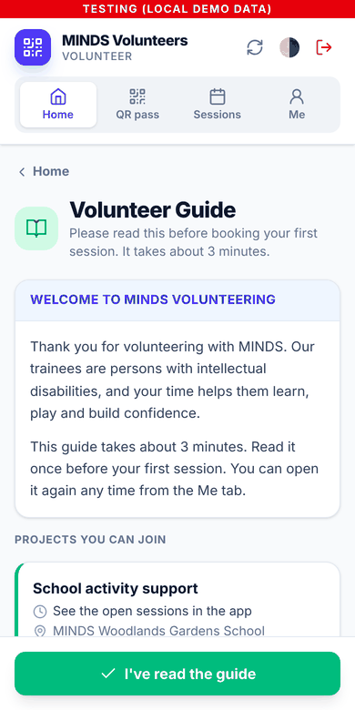
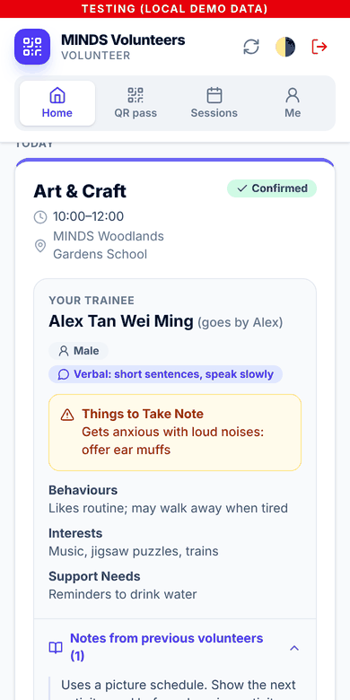
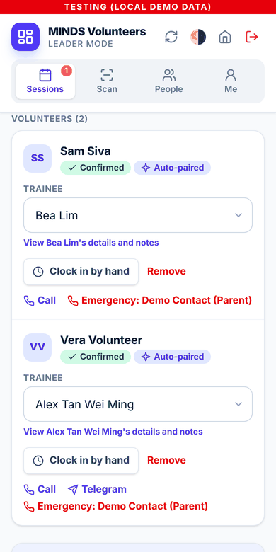
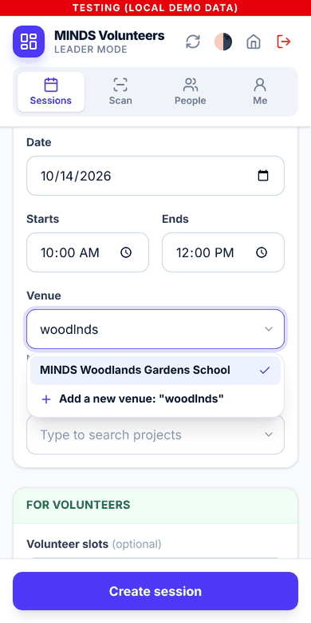
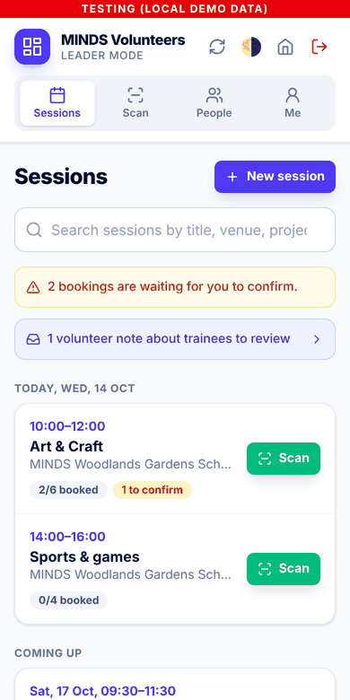
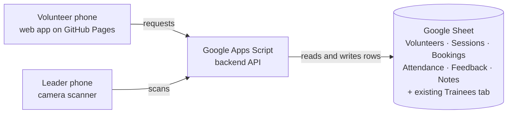

# MINDS Volunteer App

A phone app for **MINDS** volunteering, built for NTU Tech for Good (Semester 1, AY2026/27).
It replaces paper attendance and manual hour logging. Volunteers book sessions and show a
QR pass, leaders scan it to clock them in and out, and the hours are recorded in a Google
Sheet straight away.

<table>
  <tr>
    <td></td>
    <td></td>
    <td></td>
    <td></td>
    <td></td>
  </tr>
  <tr>
    <td align="center"><sub>Guide for new volunteers</sub></td>
    <td align="center"><sub>Your trainee</sub></td>
    <td align="center"><sub>Auto-pairing</sub></td>
    <td align="center"><sub>Venue dropdown</sub></td>
    <td align="center"><sub>Leader sessions</sub></td>
  </tr>
</table>

<sub>Screenshots use the local demo; every person in them is fictional.</sub>

**Status:** working prototype. It runs fully on a laptop with demo data. Connecting it to
Google Apps Script and a real Google Sheet is the next stage (see
[Part 3](#part-3-integrating-google-apps-script--google-sheets)).

| Part | What it covers |
| --- | --- |
| [Part 1: App features](#part-1-app-features) | What volunteers and leaders can do today |
| [Part 2: Test environment](#part-2-setting-up-the-test-environment) | Run the tests and the local demo on your own computer |
| [Part 3: Apps Script & Google Sheets](#part-3-integrating-google-apps-script--google-sheets) | How to connect the app to Google, from test sheet to production |
| [Part 4: Reference](#part-4-reference) | Sheet tabs, repo layout, team workflow, troubleshooting, limits |

The repo also contains **Prototype 1**, an earlier offline staff app. See
[docs/prototype-1/README.md](../docs/prototype-1/README.md). The [repository README](../README.md)
gives an overview of both apps.

---

## Part 1: App features

### For volunteers

| Feature | What it does |
| --- | --- |
| **1. Register and profile** | Sign up with name, birthday, email, phone, Telegram and emergency contact. Edit details later under **Me**. |
| **2. Volunteer Guide** | New volunteers read a short guide (projects, what to wear, expectations) and tap **I've read the guide** before their first booking. |
| **3. Find and book sessions** | Browse upcoming sessions with forgiving search, so a typo like "carnval" still finds "Sports carnival helpers". |
| **4. Meet your trainee** | After a booking is confirmed, see the paired trainee's preferred name, gender, communication style, behaviours, things to take note, interests, support needs, and recent notes from earlier volunteers. |
| **5. QR pass** | Show a QR code to clock in and out. Passes are stored on the phone, so they work without signal. |
| **6. Feedback** | Rate the session and leave an observation for the next volunteer paired with that trainee. |

### For volunteer leaders

| Feature | What it does |
| --- | --- |
| **1. Post sessions** | Create sessions with a venue dropdown (starts with MINDS Woodlands Gardens School, and more can be added), an optional project, and the trainees attending. |
| **2. Confirm bookings and auto-pairing** | Confirming a booking pairs the volunteer with a trainee automatically: the same trainee as last time if they're free, otherwise the one with the fewest pairings. Leaders can change any pairing by typing a name. |
| **3. Scan to clock in/out** | Scan a volunteer's pass with the phone camera. Supports walk-ins, scans made offline (sent when signal returns) and clocking in by hand. |
| **4. Review notes** | Volunteer observations stay private until a leader shares them as trainee notes. Leaders can also add or hide notes. |
| **5. Manage content and people** | Edit the Volunteer Guide, projects and venues. Edit anyone's details, change roles, reset passwords and deactivate accounts. |

### Behind the scenes

- **Every action is written to a Google Sheet.** Hours, bookings, feedback and notes are
  rows that staff can read, filter and correct directly.
- **Works with MINDS's existing trainee list.** The app reads the trainee tab by column
  header names and never deletes or reorders existing data.
- **Privacy:** volunteers only see the trainee fields they need for a session. Medical and
  caregiver details stay visible to leaders only.
- **Installable** on a phone home screen as a web app (PWA). No app store needed.

Step-by-step guides for each task are in
[docs/USER-GUIDE.md](docs/USER-GUIDE.md), and the reasons
behind the design are in [DESIGN-NOTES.md](DESIGN-NOTES.md).

### How it fits together



| Layer | Technology | Where it lives |
| --- | --- | --- |
| Phone app | HTML, vanilla JavaScript, Tailwind CSS | `volunteer-app/web/`, published to GitHub Pages |
| Backend API | Google Apps Script | `volunteer-app/gas/`, pasted or pushed into an Apps Script project |
| Database | Google Sheets | A sheet owned by MINDS |
| Deployment | GitHub Actions + clasp | `.github/workflows/` |

The web page is hosted on GitHub Pages rather than Apps Script because pages served by
Apps Script can no longer get camera permission, which the QR scanner needs.

---

## Part 2: Setting up the test environment

The test environment runs **the real backend code** against a pretend spreadsheet held
in memory. You don't need a Google account, internet access or real data.

### Step 1: Install the tools (once)

| Tool | Check with | Needed | Get it |
| --- | --- | --- | --- |
| Git | `git --version` | any version | Mac: `xcode-select --install`. Windows: [git-scm.com](https://git-scm.com) |
| Node.js | `node -v` | **20 or later** | [nodejs.org](https://nodejs.org) (LTS installer) |

Mac: use **Terminal** (Cmd+Space, then type "Terminal"). Windows: use **PowerShell** or
**Git Bash**.

### Step 2: Get the code

```bash
cd ~
git clone https://github.com/vcoder302026/T4G-Sem12627-MINDS-APP.git
cd T4G-Sem12627-MINDS-APP/volunteer-app
```

There's nothing to `npm install`, because the volunteer app has no dependencies. Run every
`npm` command in this README from the `volunteer-app` folder.

> **Paths with spaces:** if a folder is named like `T4G-Sem12627-MINDS-APP 2`, put the path in
> quotes: `cd "/Users/you/Downloads/T4G-Sem12627-MINDS-APP 2/volunteer-app"`. You can also type
> `cd ` with a space and drag the folder from Finder into Terminal.

### Step 3: Run the automated tests

```bash
npm test
```

Expected result: `# tests 37`, `# pass 37`, `# fail 0`. The tests cover the full flow:
register, read the guide, book, pair a trainee, scan in and out, give feedback, and write
trainee notes. They also run automatically on every pull request.

### Step 4: Start the local demo

```bash
npm run dev
```

You should see:

```
MINDS Volunteer app (local mock) → http://localhost:5173
  Leader:    leader@example.com / LeaderDemo123
  Volunteer: volunteer@example.com / VolunteerDemo123
  Sheet view: http://localhost:5173/__sheet
```

Open **<http://localhost:5173>** and sign in with a demo account:

| Role | Email | Password |
| --- | --- | --- |
| Volunteer leader | `leader@example.com` | `LeaderDemo123` |
| Volunteer | `volunteer@example.com` | `VolunteerDemo123` |
| Second volunteer | `sam@example.com` | `VolunteerDemo123` |

Open **<http://localhost:5173/__sheet>** in another tab to see what the app would write to
Google Sheets. Refresh it after each action.

- To **stop** the demo, press **Ctrl+C**. All demo data resets when it stops.
- To use **another port**, run `PORT=5174 npm run dev`.

### Step 5: Walk through the main flow

Use a normal browser window for the volunteer and a private or incognito window for the
leader, so you can be signed in as both at once.

| # | As | Do this | Check that |
| --- | --- | --- | --- |
| 1 | New user | Register with fictional details | You're asked to read the Volunteer Guide before booking |
| 2 | Volunteer | Book an upcoming session | The booking shows as pending |
| 3 | Leader | Open the session and confirm the booking | A trainee is paired automatically |
| 4 | Volunteer | Open the session | The trainee's profile and notes appear |
| 5 | Volunteer + Leader | Open the QR pass, then clock in by hand as the leader | A row appears in **Attendance** in `/__sheet` |
| 6 | Volunteer | Submit feedback with a trainee observation | It waits for a leader to review it |
| 7 | Leader | Share the observation | It appears in **Trainee Notes** |
| 8 | Leader | Add a venue, edit the guide, edit a volunteer's details | The changes show up in the app and in `/__sheet` |

### Step 6: Check the phone layout

- **Chrome:** press Cmd+Option+I (Windows: F12), then click the phone icon.
- **Safari:** choose **Develop → Enter Responsive Design Mode**. If there's no Develop
  menu, turn it on in Settings → Advanced.
- **Real phone:** connect it to the same Wi-Fi as your computer. Find your computer's IP
  address (Mac: `ipconfig getifaddr en0`; Windows: `ipconfig`) and open
  `http://<IP>:5173` on the phone.

The **camera scanner only works on HTTPS**, so real QR scanning is tested on the live site
once Google is connected (Part 3, Stage 6).

---

## Part 3: Integrating Google Apps Script & Google Sheets

This is the path from the local demo to a live app backed by Google. The backend code in
`volunteer-app/gas/` is the same code the tests run, so no code changes are needed. You
only connect it to Google.

### The three environments

| Environment | Backend | Data | Banner in the app | Use it for |
| --- | --- | --- | --- | --- |
| **Local demo** | `npm run dev` | In memory, fictional | Red "Testing (local demo data)" | Development and quick testing (Part 2) |
| **Exp** | Apps Script project #1 | A **test copy** of the sheet, fictional data | Purple "Experimentation" | Testing with real phones and QR scanning |
| **Prod** | Apps Script project #2 | The real MINDS sheet | None | Real volunteers, after sign-off |

Always set up **Exp first** and only move to Prod once Exp has been tested end to end.

### What you'll need

- A Google account that will **own** the Apps Script project. For Prod, this should be a
  MINDS-owned account, not a student's personal account.
- Edit access to the Google Sheet.
- Admin access to this GitHub repo, to set variables and secrets.

### Stage 1: Prepare the Google Sheet

1. For Exp, create a **new Google Sheet** or make a copy of the MINDS sheet and replace every
   real person with fictional data.
2. Add a tab named **`Trainees`**, or use the existing trainee tab. The app finds columns by
   **header text in row 1**, so column order doesn't matter. The default headers are:

   | Header | Required? | Shown to volunteers? |
   | --- | --- | --- |
   | `Name` | **Yes** | Leaders only |
   | `Preferred Name`, `Gender`, `Communication`, `Behaviours`, `Things to Take Note`, `Interests`, `Support Needs` | No | Yes, to the paired volunteer |
   | `Medical Notes`, `Caregiver Name`, `Caregiver Phone` | No | Leaders only |
   | `Active` | No | "No" keeps a trainee out of auto-pairing |
   | `Trainee ID` | No | Filled in automatically by `setup()` |

3. If MINDS's headers are worded differently, change the **right-hand side** of
   `TRAINEES.columns` in [`gas/Config.gs`](gas/Config.gs) to match.
   For example, `communication: 'Comms Style'`.
4. You don't need to create any other tabs. `setup()` does that in Stage 4.

### Stage 2: Create the Apps Script project

**Option A: copy and paste (simplest)**

1. In the sheet, open **Extensions → Apps Script**.
2. For each file in [`gas/`](gas), create a script file with the
   same name (**+ → Script**) and paste in its contents: `Admin`, `Attendance`, `Auth`,
   `Config`, `Content`, `Db`, `Main`, `Profile`, `Setup`, `Trainees`, `Util`, `Volunteer`.
   Delete the default `Code.gs`.
3. In **Project Settings** (the gear icon), tick **Show "appsscript.json" manifest file in
   editor**. Then replace that file's contents with
   [`gas/appsscript.json`](gas/appsscript.json).

**Option B: clasp (recommended once you update code often)**

```bash
cd volunteer-app                    # from the repository root
npm run clasp:login                 # sign in with the Google account that owns the script
cp .clasp.json.example .clasp.json  # then paste your Script ID into .clasp.json
npm run gas:push                    # uploads everything in gas/
```

You can find the Script ID under Apps Script → Project Settings → IDs. `.clasp.json` and
`.clasprc.json` are in `.gitignore`. **Never commit them.**

### Stage 3: Set the script properties

In Apps Script, go to **Project Settings → Script properties → Add script property**:

| Property | Value | Required? |
| --- | --- | --- |
| `SPREADSHEET_ID` | The long ID in the sheet's URL, between `/d/` and `/edit` | **Yes** |
| `TRAINEE_SPREADSHEET_ID` | ID of a separate file, only if trainees live elsewhere | No |
| `FIRST_ADMIN_EMAIL` | Your email, added in Stage 7 | Later |

Sheet IDs are kept here rather than in the code, so they never end up on GitHub.

### Stage 4: Run `checkConfig()` and then `setup()`

1. In the Apps Script editor, open `Setup.gs`, choose **`checkConfig`** in the function
   dropdown, and click **Run**. Approve the permission prompt. The app only asks for
   access to spreadsheets.
2. Read the **Execution log** at the bottom of the editor. It lists what `setup()` would add,
   without changing anything.
3. Run **`setup()`**. It:
   - creates the app's tabs (Volunteers, Sessions, Bookings, Attendance, Feedback, Trainee
     Notes, Venues, Projects, Volunteer Guide, and the hidden `_Auth`);
   - adds any missing columns to existing tabs;
   - gives every trainee a Trainee ID;
   - adds a starter venue, guide and project;
   - creates the `APP_SECRET` property, which signs logins and QR passes. **Never share or
     delete it.**

   It never deletes or overwrites data, and it's safe to run again. **Run it again after
   every code update.**

### Stage 5: Deploy the backend as a web app

1. Click **Deploy → New deployment**, then click the gear icon and choose **Web app**.
2. Set **Execute as: Me** and **Who has access: Anyone**.
3. Click **Deploy** and copy the **Web app URL**. It ends in `/exec`.
4. Also note the **Deployment ID**. You'll need it in Stage 8.

**Anyone** is required because the phone app calls the backend directly. The backend does
its own sign-in checks on every request.

### Stage 6: Connect the phone app (GitHub Pages)

1. In GitHub, go to **Settings → Pages → Source** and choose **GitHub Actions** (once).
2. Go to **Settings → Secrets and variables → Actions → Variables** and add:

   | Variable | Value |
   | --- | --- |
   | `APP_ENVIRONMENT` | `Exp` |
   | `GAS_EXP_URL` | The `/exec` URL from Stage 5 |

3. Go to **Actions → Volunteer app · deploy web → Run workflow**. After that, it runs by
   itself whenever `volunteer-app/web/` changes on `main`.
4. Open the site. The link is under Settings → Pages and looks like
   `https://vcoder302026.github.io/T4G-Sem12627-MINDS-APP/`.

The URL is added to `web/js/config.js` during deployment, so it's never committed to the repo.

### Stage 7: Create the first leader

1. Register an account on the live site.
2. Add the script property `FIRST_ADMIN_EMAIL` with that email.
3. Run **`makeFirstAdmin()`** in `Setup.gs`.
4. Sign out and back in. You're now a leader and can promote others from inside the app.

**Now test on real phones:** one phone shows a volunteer's QR pass and the leader's phone
scans it. Check that the row appears in the **Attendance** tab.

### Stage 8: Automatic backend deploys (optional)

Without this, every backend code change means pasting files again (or running `npm run gas:push`) and then
**Deploy → Manage deployments → ✏️ → Version: New version**. Otherwise, the live URL keeps
serving the old code.

To have GitHub do it on every merge to `main`, add these repository **Secrets** (Settings →
Secrets and variables → Actions → Secrets):

| Secret | Where to get it |
| --- | --- |
| `CLASPRC_JSON` | Contents of `~/.clasprc.json` after `npm run clasp:login` |
| `GAS_SCRIPT_ID` | Apps Script → Project Settings → Script ID |
| `GAS_DEPLOYMENT_ID` | Deploy → Manage deployments → the web app's Deployment ID |

The workflow runs the tests, pushes the code, and updates the **existing** deployment, so
the `/exec` URL never changes and phones keep working. Without the secrets, it still runs
the tests and skips the deploy. Remember to run `setup()` again after updates that add
columns.

### Stage 9: Going to production (future)

Only start this after Exp has been tested end to end and MINDS has agreed.

1. **Create a separate Apps Script project** on the real MINDS sheet (repeat Stages 2–5).
   Script properties belong to each project, so Exp and Prod never share data or secrets.
2. Add the repository variables `GAS_PROD_URL` (the Prod `/exec` URL) and change
   `APP_ENVIRONMENT` to `Prod`. Then run the web deploy workflow again.
3. The automatic backend deploy (Stage 8) targets one project. Point its secrets at the
   project you want to update, or keep Prod updates manual.

**Production checklist:**

- [ ] The Apps Script project is owned by a MINDS account, not a student account.
- [ ] Back up the real sheet (File → Make a copy) before the first `setup()`.
- [ ] Review `TRAINEES.volunteerVisible` in `Config.gs` with MINDS. Volunteers should see
      only what they need, in line with PDPA.
- [ ] Review the switches in `Config.gs` (for example `AUTO_PAIR_ON_CONFIRM`,
      `AUTO_SHARE_OBSERVATIONS`, `REQUIRE_GUIDE_BEFORE_BOOKING`).
- [ ] Review the known limits: password hashing uses HMAC-SHA256 because Apps Script has no
      bcrypt, emails aren't verified, and Apps Script handles about 30 requests at once.
      See [Limits of this prototype](#limits-of-this-prototype).
- [ ] Make the first leader with `makeFirstAdmin()`, then remove `FIRST_ADMIN_EMAIL`.

### Key settings in `Config.gs`

| Setting | Default | What it does |
| --- | --- | --- |
| `TRAINEES.columns` | MINDS-style headers | Your trainee tab's header names |
| `TRAINEES.volunteerVisible` | preferred name, gender, communication, behaviours, things to take note, interests, support needs | What a paired volunteer sees |
| `AUTO_PAIR_ON_CONFIRM` | `true` | Pair a trainee automatically when a booking is confirmed |
| `AUTO_SHARE_OBSERVATIONS` | `false` | Share volunteer notes without a leader's review |
| `REQUIRE_GUIDE_BEFORE_BOOKING` | `true` | New volunteers read the guide before their first booking |
| `ALLOW_SHARED_TRAINEE` | `false` | Let two volunteers share a trainee in one session |
| `DEFAULT_VENUES` | MINDS Woodlands Gardens School | Venues `setup()` adds when the Venues tab is empty |

---

## Part 4: Reference

### What's in the sheet

| Tab | One row per | Notes |
| --- | --- | --- |
| Volunteers | person | Profile, emergency contact, Role (`volunteer`/`admin`), Status (`inactive` blocks sign-in) |
| _Auth (hidden) | person | Salted password hashes. Never shown in the app |
| Sessions | session | Venue, project, trainees attending; status `open` / `closed` / `cancelled` |
| Bookings | booking | `pending` → `confirmed` or `cancelled`; paired trainee; walk-in flag |
| Attendance | clock record | Clock in, clock out, hours, who scanned, method (`QR`, `QR (offline)`, `Manual`) |
| Feedback | submission | Rating 1–5, comments, trainee observation, review status |
| Trainee Notes | note | What future volunteers see; `shared` or `hidden` |
| Venues, Projects, Volunteer Guide | item | Editable by leaders in the app |
| Trainees (existing) | trainee | Read by the app. It only adds Trainee ID, missing columns and two observation columns |

Staff can edit the sheet directly, for example to fix a clock-out time. The app re-reads
it on every request. Only rename a header together with `Config.gs`.

### Repository layout

```
volunteer-app/
  gas/              Apps Script backend (goes into the Apps Script project)
  web/              phone app (published to GitHub Pages)
  dev/              local demo server and in-memory Google Sheets stand-in
  tests/            backend tests (npm test)
  docs/             user guide and screenshots
  README.md         this file
  DESIGN-NOTES.md   why it's built this way
.github/workflows/  deploy web (GitHub Pages) and backend (clasp)
docs/prototype-1/   Prototype 1 README and usage guide
server/ public/ tests/  Prototype 1 code (Node.js 24: npm install && npm test && npm start)
PROGRESS.md         progress log
```

### Team workflow

1. Create a branch: `git checkout -b my-change`.
2. Make your change and run `cd volunteer-app && npm test`.
3. Push and open a pull request into `main`. The tests run automatically.
4. Merging to `main` publishes the web app, and the backend too if Stage 8 is set up.

Use **fictional data only** in code, tests and screenshots. Never commit `.clasp.json`,
`.clasprc.json`, Sheet IDs or `/exec` URLs. Use script properties and repository
variables instead.

### Troubleshooting

| What you see | Fix |
| --- | --- |
| `cd: no such file or directory` | The folder isn't where you typed. Find it with `find ~ -maxdepth 4 -type d -name volunteer-app` and use quotes if the path has spaces. |
| `npm error enoent Could not read package.json` | You're in the wrong folder. Run `pwd`, then `cd` into `volunteer-app`. |
| `node: command not found` | Install Node.js LTS from nodejs.org, then open a new Terminal window. |
| `EADDRINUSE` (port in use) | The demo is already running elsewhere. Press Ctrl+C there, or run `PORT=5174 npm run dev`. |
| Demo data disappeared | Expected. The local demo resets when stopped. |
| Live site: "Couldn't reach the server" | Check that `GAS_EXP_URL` ends in `/exec`, web app access is **Anyone**, and you reran the web deploy. |
| `SPREADSHEET_ID is not set` or "tab was not found" | Add the script property and run `setup()`. |
| Code change isn't live | Publish a **New version** of the existing deployment, or set up Stage 8. |
| Camera doesn't start | Use the HTTPS GitHub Pages site and allow camera access in the browser. |

How each screen works for volunteers and leaders: [docs/USER-GUIDE.md](docs/USER-GUIDE.md).

### Limits of this prototype

- Passwords use iterated HMAC-SHA256 with a secret pepper (Apps Script has no
  bcrypt or scrypt). Review before a real launch.
- Emails aren't verified. Someone registering with an email already on the
  Volunteers list links to that row (always as a volunteer, never a leader).
- Apps Script requests take 1–2 s and handle about 30 at once: fine for
  session-sized groups, not for thousands of simultaneous users.
- Pairing doesn't consider gender, skills or preferences yet; leaders adjust it.
- Trainee details are edited in the trainee sheet, not in the app.
- The scanner library (`html5-qrcode` 2.3.8) is no longer actively maintained;
  it loads from a CDN with a fallback and is cached for offline use.
- Agree with MINDS which trainee fields volunteers may see (PDPA).
