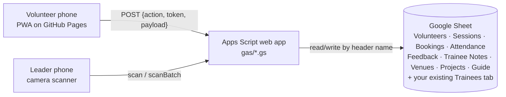

# MINDS Volunteer App

A phone app for MINDS volunteering that replaces paper attendance and manual
hour logging. Volunteers book sessions and show a QR pass; leaders scan it to
clock them in and out, and the hours land in a Google Sheet straight away.

Built on the WERONE stack: **Google Apps Script** (backend API) + **Google
Sheets** (database) + **HTML, vanilla JavaScript and Tailwind** (installable
PWA on GitHub Pages), deployed with **GitHub Actions + clasp**. It looks and
behaves like the other WERONE apps (CSL Attendance, Trainee House Visit,
Overseas Trip Planner).

<table>
  <tr>
    <td></td>
    <td></td>
    <td></td>
    <td></td>
    <td></td>
  </tr>
  <tr>
    <td align="center"><sub>Guide for new volunteers</sub></td>
    <td align="center"><sub>Your trainee</sub></td>
    <td align="center"><sub>Auto-pairing</sub></td>
    <td align="center"><sub>Venue dropdown</sub></td>
    <td align="center"><sub>Leader sessions</sub></td>
  </tr>
</table>

<sub>Screenshots use the local demo; every person in them is fictional.</sub>

## Contents

- [Features](#features)
- [Try it locally](#try-it-locally)
- [Set it up on Google](#set-it-up-on-google)
- [Configuration](#configuration)
- [What's in the sheet](#whats-in-the-sheet)
- [Working on the code](#working-on-the-code)
- [Troubleshooting](#troubleshooting)
- [Limits of this prototype](#limits-of-this-prototype)

## Features

**Volunteers**
- Register with their details (name, birthday, email, phone, Telegram, emergency contact) and edit them later under Me.
- Read a short **Volunteer Guide** (projects, what to wear, expectations) before their first booking.
- Find and book sessions, with forgiving search ("carnval" finds "Sports carnival helpers").
- Once confirmed, see their **trainee**: gender, verbal or non-verbal communication, behaviours, things to take note, and recent notes from previous volunteers.
- Show a **QR pass** to clock in and out. It works without signal.
- Give feedback after the session, including notes for the next volunteer paired with that trainee.

**Volunteer leaders**
- Post sessions with a **venue dropdown** (starts with MINDS Woodlands Gardens School; add more any time), an optional project and the trainees attending.
- Confirm bookings, and trainees are **paired automatically** (same trainee as last time when free, otherwise the one with the fewest pairings). Change any pairing by typing a name.
- **Scan passes** to clock volunteers in and out, including walk-ins, offline scans and clocking by hand.
- **Review** volunteers' notes before future volunteers see them; add or hide trainee notes.
- Edit the Volunteer Guide, projects and venues; edit anyone's details (including other leaders), change roles, reset passwords, deactivate accounts.

How each task works, step by step: **[docs/USER-GUIDE.md](docs/USER-GUIDE.md)**.
Why it's built this way: **[DESIGN-NOTES.md](DESIGN-NOTES.md)**.



> **Why GitHub Pages and not Apps Script for the web page?** Since around
> February 2026, pages served by Apps Script can't get camera permission, so a
> QR scanner there fails. The page lives on GitHub Pages and calls Apps Script as an API.

## Try it locally

No Google account needed. You need [Node.js](https://nodejs.org) 20 or later.

```bash
cd volunteer-app
npm run dev        # → http://localhost:5173
```

| Role | Email | Password |
| --- | --- | --- |
| Volunteer leader | `leader@example.com` | `LeaderDemo123` |
| Volunteer | `volunteer@example.com` | `VolunteerDemo123` |
| Second volunteer | `sam@example.com` | `VolunteerDemo123` |

Register a new account to see the first-time flow. The demo runs the real
`gas/*.gs` code against an in-memory spreadsheet: open
<http://localhost:5173/__sheet> to see what would be written to Google Sheets.
Data resets when you stop the server.

A phone on the same Wi-Fi can open `http://<your-computer's-IP>:5173`. The
camera needs HTTPS, so test real scanning on the published GitHub Pages site.

## Set it up on Google

1. **Create the Apps Script project.** Open your sheet → Extensions → Apps
   Script. Create one script file per file in [`gas/`](gas) (same names) and
   paste each one in. In Project Settings tick "Show appsscript.json" and paste
   [`gas/appsscript.json`](gas/appsscript.json). (Or use clasp: `npm run clasp:login`,
   copy `.clasp.json.example` to `.clasp.json` with your Script ID, `npm run gas:push`.)
2. **Point it at your sheet.** Project Settings → Script properties → add
   `SPREADSHEET_ID` (the long ID in the sheet's URL). Trainees in another file?
   Also add `TRAINEE_SPREADSHEET_ID`.
3. **Match your trainee columns.** In [`gas/Config.gs`](gas/Config.gs) →
   `TRAINEES.columns`, set the right-hand side to your header names. Only a
   name column is required.
4. **Run `checkConfig()`, then `setup()`** (in `Setup.gs`). Setup adds the app's
   tabs and any missing columns, gives trainees IDs, adds a starter venue, guide
   and project, and creates `APP_SECRET`. It never deletes or overwrites data,
   and is safe to re-run. **Run it again after every code update.**
5. **Deploy the API.** Deploy → New deployment → Web app → Execute as **Me**,
   Who has access **Anyone** → copy the URL ending in `/exec`.
6. **Publish the web app.** Put the URL in [`web/js/config.js`](web/js/config.js)
   (or set repository variables `APP_ENVIRONMENT`, `GAS_EXP_URL`, `GAS_PROD_URL`).
   Repo Settings → Pages → Source: **GitHub Actions**. Each push to `main` that
   changes `volunteer-app/web/` republishes the site.
7. **Make the first leader.** Register in the app, add the script property
   `FIRST_ADMIN_EMAIL` with that email, and run `makeFirstAdmin()`. After that,
   leaders promote others in the app.

Changed `.gs` code by hand? Deploy → Manage deployments → ✏️ → Version **New
version**, or the live URL keeps serving the old code. To deploy the backend
automatically on every push instead, add the three secrets listed at the top
of [`.github/workflows/volunteer-app-gas.yml`](../.github/workflows/volunteer-app-gas.yml).

## Configuration

**Script properties** (Apps Script → Project Settings)

| Name | What it does |
| --- | --- |
| `SPREADSHEET_ID` | The sheet the app uses (required) |
| `TRAINEE_SPREADSHEET_ID` | Only if the trainee list is in a different file |
| `FIRST_ADMIN_EMAIL` | Used once by `makeFirstAdmin()` |
| `APP_SECRET` | Created by `setup()`; signs sign-ins and QR passes. Never share or delete it |

**Switches in [`gas/Config.gs`](gas/Config.gs)**

| Setting | Default | What it does |
| --- | --- | --- |
| `TRAINEES.columns` | MINDS-style headers | Your trainee tab's header names |
| `TRAINEES.volunteerVisible` | preferred name, gender, communication, behaviours, things to take note, interests, support needs | What a paired volunteer sees. Medical and caregiver details stay leaders-only |
| `AUTO_PAIR_ON_CONFIRM` | `true` | Pair a trainee automatically when a booking is confirmed |
| `AUTO_SHARE_OBSERVATIONS` | `false` | Share volunteer notes without a leader's review |
| `NOTES_SHOWN_TO_VOLUNTEERS` | `5` | How many recent notes a paired volunteer sees |
| `REQUIRE_GUIDE_BEFORE_BOOKING` | `true` | New volunteers read the guide before their first booking |
| `DEFAULT_VENUES` | MINDS Woodlands Gardens School | Venues `setup()` adds when the Venues tab is empty |
| `ALLOW_SHARED_TRAINEE` | `false` | Let two volunteers share a trainee in one session |

**Web app** ([`web/js/config.js`](web/js/config.js)): `APP_ENVIRONMENT` is `Exp`
(purple bar), `Dev` (red bar) or `Prod` (no bar), with separate Exp and Prod API URLs.

## What's in the sheet

| Tab | One row per | Notes |
| --- | --- | --- |
| Volunteers | person | Profile, emergency contact, Role (`volunteer`/`admin`), Status (`inactive` blocks sign-in), Guide Read At, Details Updated By/At |
| _Auth (hidden) | person | Salted password hashes; never shown in the app |
| Sessions | session | Venue, Project, Trainees Attending; Status `open` / `closed` / `cancelled` |
| Bookings | booking | `pending` → `confirmed` or `cancelled`; Trainee; Pairing `auto`/`manual`; Walk-in |
| Attendance | clock record | Clock In, Clock Out, Hours, who scanned, Method (`QR`, `QR (offline)`, `Manual`) |
| Feedback | submission | Rating 1–5, comments, trainee observation, Note Status (`pending`/`shared`/`private`) |
| Trainee Notes | note | What future volunteers see; Status `shared` or `hidden` |
| Venues | venue | Name, Address (for the Maps link), Status `active`/`archived` |
| Projects | project | Shown in the guide and the session form |
| Volunteer Guide | section | Heading and content; lines starting `- ` become bullet points |
| Trainees (yours) | trainee | Read by the app; it only adds Trainee ID, empty columns for missing fields, and two observation columns |

Staff can edit the sheet directly (for example, to fix a clock-out time); the app
re-reads it on every request. Rename a header only together with `Config.gs`.

## Working on the code

```
volunteer-app/
├── gas/              Apps Script backend (these files go into the Apps Script project)
│   ├── Main.gs       the API: doPost + the table of actions (routes_)
│   ├── Config.gs     tab names, column mapping, switches
│   ├── Setup.gs      checkConfig(), setup(), makeFirstAdmin()
│   ├── Auth.gs       registration, sign-in, roles      Profile.gs   editing details
│   ├── Volunteer.gs  volunteer home, booking, feedback Admin.gs     sessions, confirming
│   ├── Attendance.gs QR clock-in/out                   Trainees.gs  pairing, trainee notes
│   ├── Content.gs    guide, projects, venues
│   └── Db.gs, Util.gs  Sheets as tables, validation, dates, signing
├── web/              the phone app (published to GitHub Pages)
│   ├── js/app.js     header, tabs, routes, on-phone caches, offline scan queue
│   ├── js/ui.js      DOM helpers, icons, fuzzy search, dropdowns, pop-ups
│   ├── js/views/     screens: auth, volunteer, leader, trainees, content, profile
│   └── src/input.css Tailwind source (built into styles.css)
├── dev/              local demo server and the in-memory Google Sheets stand-in
├── tests/            backend tests
└── docs/             user guide and screenshots
```

```bash
npm run dev         # local demo with the real backend code
npm test            # 37 backend tests: register → guide → book → pair → scan → feedback → notes
npm run build:css   # rebuild web/styles.css after changing Tailwind classes (CI does this too)
```

**Adding a feature** usually means:
1. a function in the right `gas/*.gs` file, validating its input with the
   helpers in `Util.gs` (`str_`, `date_`, `onlyFields_`…);
2. one line in `routes_()` in `Main.gs`: `auth` (`public`, `user` or `admin`)
   and `write: true` if it changes the sheet (so it runs under a lock);
3. a test in `tests/gas.test.js`;
4. the screen in `web/js/views/`, calling it with `call('yourAction', payload)`.
   Render data with `el()` (text only, never `innerHTML`) and add any new file
   to the `SHELL` list in `web/sw.js` so it works offline.

**Team workflow:** work on a branch, run `npm test`, open a pull request into
`main`. Merging publishes the web app; with the Apps Script secrets set, it also
deploys the backend. Keep test data fictional, and never commit `.clasprc.json`,
`.clasp.json` or real Apps Script URLs and Sheet IDs from other projects.

## Troubleshooting

| Symptom | Fix |
| --- | --- |
| "Couldn't reach the server" everywhere | Web app access must be **Anyone**; publish a new version; the URL in `config.js` must end in `/exec`. |
| `SPREADSHEET_ID is not set` or "tab was not found" | Add the script property; run `setup()` (also after a code update). |
| Camera doesn't start | Use the HTTPS site (GitHub Pages); allow the camera in browser settings; close other camera apps. |
| "This QR code is for 2026-…" | The volunteer is showing an old screenshot; reopen the pass in the app. |
| "Please read the Volunteer Guide before booking" | Read it and tap **I've read the guide** (Home banner, or Me → Volunteer Guide). |
| "Choose a venue from the list" | Pick it from the dropdown or tap **+ Add a new venue**; restore archived venues under Me → Venues. |
| "No free trainee to pair" | Pick a trainee by hand, add trainees to the session's Trainees attending, or check the `Active` column. |
| Code change isn't live | Publish a **new version** of the existing deployment. |

## Limits of this prototype

- Passwords use iterated HMAC-SHA256 with a secret pepper (Apps Script has no
  bcrypt or scrypt). Review before a real launch.
- Emails aren't verified. Someone registering with an email already on the
  Volunteers list links to that row (always as a volunteer, never a leader).
- Apps Script requests take 1–2 s and handle about 30 at once: fine for
  session-sized groups, not for thousands of simultaneous users.
- Pairing doesn't consider gender, skills or preferences yet; leaders adjust it.
- Trainee details are edited in the trainee sheet, not in the app.
- The scanner library (`html5-qrcode` 2.3.8) is no longer actively maintained;
  it loads from a CDN with a fallback and is cached for offline use.
- Agree with MINDS which trainee fields volunteers may see (PDPA).
