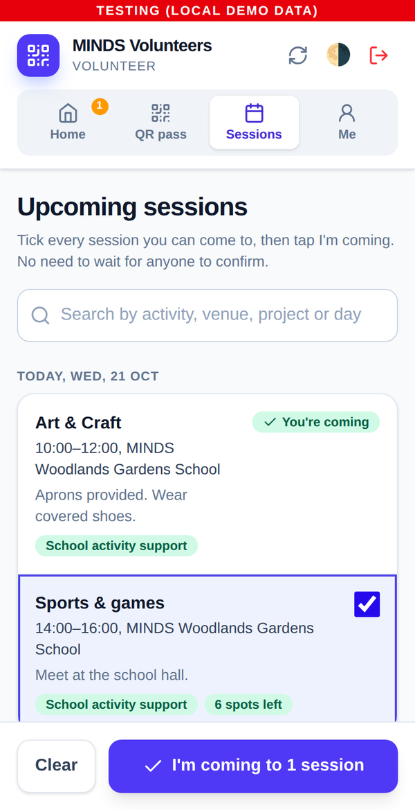
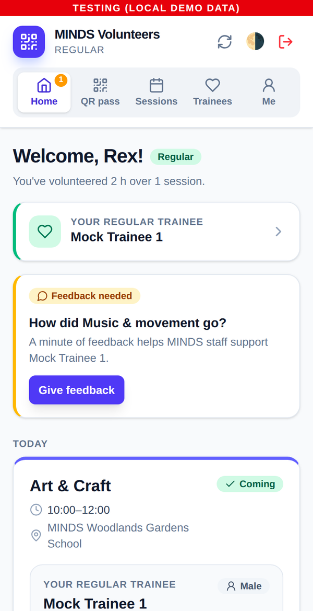
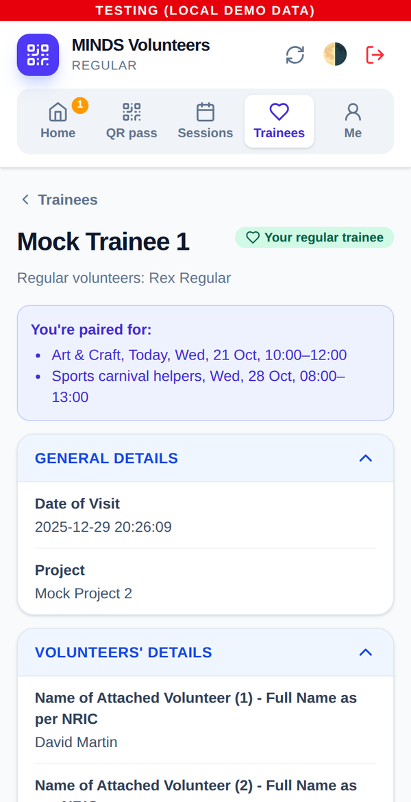
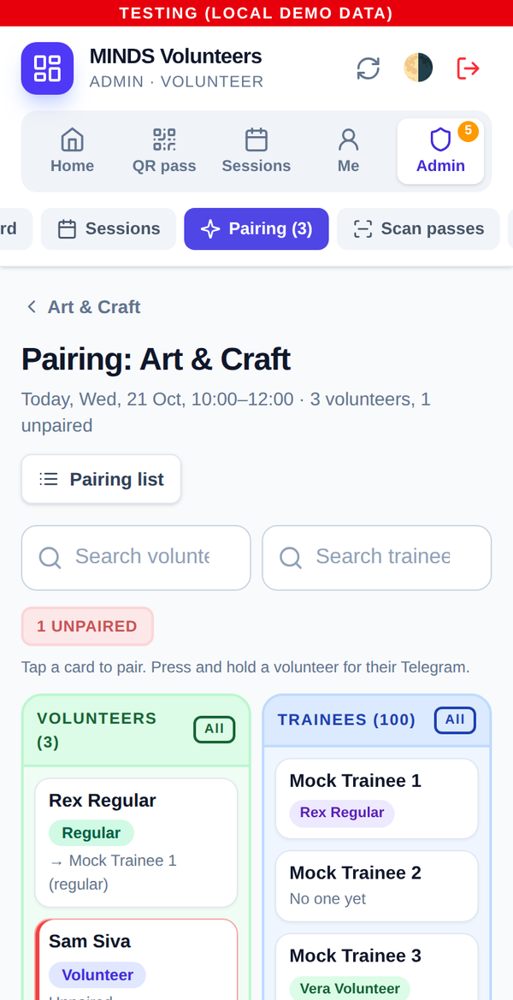
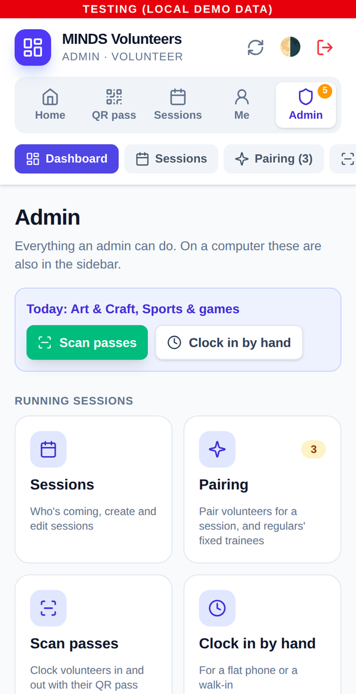
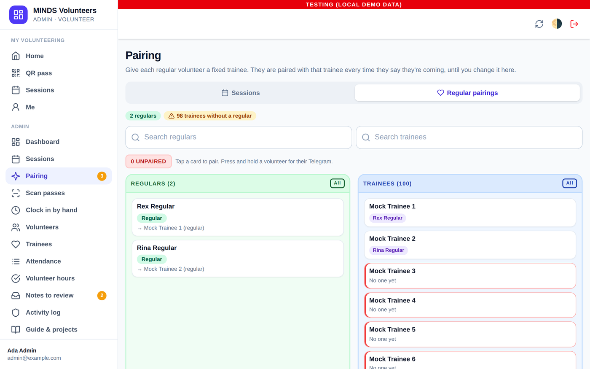
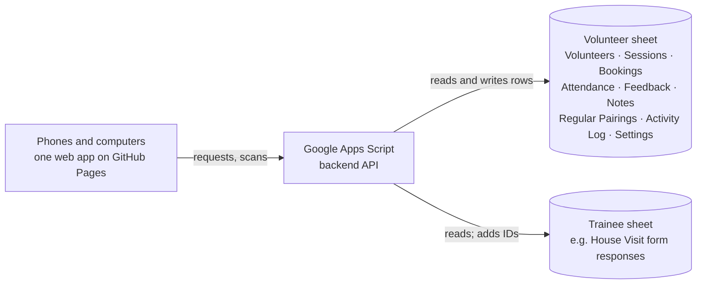

# MINDS Volunteer App

A phone app for **MINDS** volunteering, built for NTU Tech for Good (Semester 1, AY2026/27).
It replaces paper attendance and manual hour logging. Volunteers say which sessions they're
coming to and show a QR pass, admins pair them with trainees and scan the pass to clock them
in and out, and the hours are recorded in a Google Sheet straight away.

**One app for everyone.** Volunteers see Home, QR pass, Sessions and Me; regular volunteers
also see Trainees. Admins see all of that plus the **Admin** menu: sessions, pairing,
scanning, volunteers, trainees, attendance, hours, the activity log and settings. On a phone
the menu is the tab bar; on a computer it becomes a sidebar with the same pages.

<table>
  <tr>
    <td></td>
    <td></td>
    <td></td>
    <td></td>
    <td></td>
  </tr>
  <tr>
    <td align="center"><sub>"I'm coming"</sub></td>
    <td align="center"><sub>A regular's home</sub></td>
    <td align="center"><sub>Trainee details</sub></td>
    <td align="center"><sub>Pairing board</sub></td>
    <td align="center"><sub>Admin menu</sub></td>
  </tr>
</table>



<sub>Screenshots use the local demo; every person in them is fictional (the trainees are
MINDS's mock House Visit data).</sub>

**Status:** working prototype (Version 2). It runs fully on a laptop with demo data, and
connects to Google Apps Script and Google Sheets as described in
[Part 3](#part-3-integrating-google-apps-script--google-sheets). What changed since
Version 1, and why, is in [VERSION-2.md](../VERSION-2.md).

| Part | What it covers |
| --- | --- |
| [Part 1: App features](#part-1-app-features) | What volunteers, regulars and admins can do |
| [Part 2: Test environment](#part-2-setting-up-the-test-environment) | Run the tests and the local demo on your own computer |
| [Part 3: Apps Script & Google Sheets](#part-3-integrating-google-apps-script--google-sheets) | How to connect the app to Google, from test sheet to production |
| [Part 4: Reference](#part-4-reference) | Sheet tabs, repo layout, team workflow, troubleshooting, limits |

The repo also contains **Prototype 1**, an earlier offline staff app. See
[docs/prototype-1/README.md](../docs/prototype-1/README.md). The [repository README](../README.md)
gives an overview of both apps.

---

## Part 1: App features

### Three profiles

| Profile | Who | Trainees they can see | How they're paired |
| --- | --- | --- | --- |
| **Volunteer** | Everyone starts here (new / ad hoc) | Only the trainee they're paired with, and only the details admins allow | An admin pairs them for each session |
| **Regular** | After **10 attended sessions** (automatic), or promoted by an admin | Any trainee, with the details admins allow (everything by default) | An admin can give them a **fixed trainee**; it's applied every time they say they're coming, until an admin changes it |
| **Admin** | A volunteer or regular with admin access | Everything | As above, plus they pair everyone else |

A volunteer has **one trainee** per session. A trainee can have **several volunteers**,
ideally at least one regular; the app flags trainees without one.

### For every volunteer

| Feature | What it does |
| --- | --- |
| **1. Register and profile** | Sign up with name, birthday, email, phone, Telegram and emergency contact. Edit details later under **Me**. (The fields will follow MINDS's registration form once it's shared.) |
| **2. Volunteer Guide** | New volunteers read a short guide (text, plus any infographics: pictures or PDFs) and tap **I've read the guide** before their first sign-up. |
| **3. Upcoming sessions** | Every volunteer sees the upcoming sessions. Tick every one you can come to and tap **I'm coming**: no waiting for a confirmation. **Can't make it** takes you off a session. |
| **4. Your trainee** | Once paired, see your trainee's allowed details and notes from earlier volunteers, and open their full page. Regulars see their fixed trainee on Home. |
| **5. QR pass** | Show a QR code to clock in and out. Passes are stored on the phone, so they work without signal. |
| **6. Feedback and updates** | Rate a session and leave an observation, or send an update about your trainee any time. An admin reviews it before other volunteers see it. |
| **7. Progress** | Hours, sessions and "x of 10 sessions to become a regular volunteer". |
| **8. Trainees (regulars)** | Browse every trainee, read their details and send updates about any of them. |

### For admins (Admin menu)

| Feature | What it does |
| --- | --- |
| **Dashboard** | New and regular volunteers, trainees without a regular, hours, who's coming and who still needs pairing. |
| **Sessions** | Who's coming to each session (with no-shows for past ones), create, edit, close or cancel sessions. |
| **Pairing** | A pairing board per session, in the style of the WERONE outing app: volunteers beside trainees, a search box for each, an **Unpaired** count that filters, tap to pair, press and hold a volunteer for their Telegram. A **Pairing list** view gives a Volunteer → Trainee table to screenshot. **Regular pairings** sets each regular's fixed trainee. |
| **Scan passes / Clock in by hand** | Scan QR passes (works offline; uploads later). Clocking in by hand is its own page, with walk-ins. |
| **Volunteers** | Profiles, sessions, no-shows and hours. Promote to regular (or back), make or remove admins, reset passwords, **Deactivate** straight from the list. **Removing or deactivating an admin needs your own password.** |
| **Trainees** | Every trainee with all their details grouped like the House Visit form, their regular volunteers, notes, visits and history. **What volunteers see** sets the details volunteers and regulars get: a default for everyone, own settings per trainee, and "Set as default". |
| **Attendance, Volunteer hours** | Every clock-in and out; fix a missed scan; hours per volunteer, exported as CSV. |
| **Notes to review** | Session feedback and trainee updates, shared or kept private. |
| **Activity log** | Every change an admin makes, in plain English: who, what and when. Also kept in the sheet. |
| **Guide & projects** | Everything new volunteers read: add and edit text sections, and **infographics** (a JPG/PNG picture or a PDF, up to 8 MB) uploaded from your device or picked from Google Drive by its share link; move items up and down; replace or remove a file. |
| **Venues** | The venue list for sessions. |
| **Later (placeholders)** | Fundraising, outings, overseas trips and house visits from Version 1 are kept but parked until MINDS decides how they fit. |

### Behind the scenes

- **Every action is written to a Google Sheet.** Rows that staff can read, filter and correct.
- **Trainees come from MINDS's own sheet.** The trainee list can be a separate file (e.g. the
  House Visit form's responses), linked by pasting its URL. The app reads every column and
  groups them using the form's "Map (Fixed)" tab. It only adds a Trainee ID column and two
  observation columns, and never deletes or reorders rows.
- **Regular pairings can come from a sheet.** The Regular Pairings tab accepts rows typed with
  plain names (like the outing sheet's pairing list); the app matches them to accounts.
- **Privacy:** volunteers see only what admins allow, and only for their own trainee.
- **Installable** on a phone home screen as a web app (PWA). No app store needed.

Step-by-step guides for each task are in [docs/USER-GUIDE.md](docs/USER-GUIDE.md), and the
reasons behind the design are in [DESIGN-NOTES.md](DESIGN-NOTES.md).

### How it fits together



| Layer | Technology | Where it lives |
| --- | --- | --- |
| Web app (phones and computers) | HTML, vanilla JavaScript, Tailwind CSS | `volunteer-app/web/`, published to GitHub Pages. Admin pages that came from the Version 1 dashboard are in `web/admin/js/views/` |
| Backend API | Google Apps Script | `volunteer-app/gas/`, pasted or pushed into an Apps Script project |
| Database | Google Sheets | A volunteer sheet, and MINDS's trainee sheet (can be the same file) |
| Deployment | GitHub Actions + clasp | `.github/workflows/` |

The web page is hosted on GitHub Pages rather than Apps Script because pages served by
Apps Script can no longer get camera permission, which the QR scanner needs.

---

## Part 2: Setting up the test environment

The test environment runs **the real backend code** against a pretend spreadsheet held
in memory. You don't need a Google account, internet access or real data.

### Step 1: Install the tools (once)

| Tool | Check with | Needed | Get it |
| --- | --- | --- | --- |
| Git | `git --version` | any version | Mac: `xcode-select --install`. Windows: [git-scm.com](https://git-scm.com) |
| Node.js | `node -v` | **20 or later** | [nodejs.org](https://nodejs.org) (LTS installer) |

Mac: use **Terminal** (Cmd+Space, then type "Terminal"). Windows: use **PowerShell** or
**Git Bash**.

### Step 2: Get the code

```bash
cd ~
git clone https://github.com/vcoder302026/T4G-Sem12627-MINDS-APP.git
cd T4G-Sem12627-MINDS-APP/volunteer-app
```

There's nothing to `npm install`, because the volunteer app has no dependencies. Run every
`npm` command in this README from the `volunteer-app` folder.

> **Paths with spaces:** if a folder is named like `T4G-Sem12627-MINDS-APP 2`, put the path in
> quotes: `cd "/Users/you/Downloads/T4G-Sem12627-MINDS-APP 2/volunteer-app"`. You can also type
> `cd ` with a space and drag the folder from Finder into Terminal.

### Step 3: Run the automated tests

```bash
npm test
```

Expected result: `ℹ tests 66`, `ℹ pass 66`, `ℹ fail 0`. `tests/gas.test.js` covers the
main flow: register, read the guide, say you're coming, pairing (volunteers by an admin,
regulars with their fixed trainee), becoming a regular after 10 sessions, scan in and out,
feedback, trainee notes, and removing an admin with a password. `tests/dashboard.test.js`
covers the admin pages that came from the Version 1 dashboard. `tests/v2.test.js` runs
against MINDS's mock House Visit data: the trainee sheet linked by URL, the form's
sections, what volunteers and regulars may see, trainee updates and the activity log.
They also run automatically on every pull request.

### Step 4: Start the local demo

```bash
npm run dev
```

You should see:

```
MINDS Volunteer app (local mock) → http://localhost:5173
  Admin:     admin@example.com / AdminDemo123
  Regular:   regular@example.com / RegularDemo123
  Volunteer: volunteer@example.com / VolunteerDemo123
  Sheet view: http://localhost:5173/__sheet
```

Open **<http://localhost:5173>** and sign in with a demo account:

| Profile | Email | Password | In the demo |
| --- | --- | --- | --- |
| Admin | `admin@example.com` | `AdminDemo123` | Ada: the Admin menu |
| Regular | `regular@example.com` | `RegularDemo123` | Rex: fixed trainee Mock Trainee 1 |
| Regular | `rina@example.com` | `RegularDemo123` | Rina: fixed trainee Mock Trainee 2 |
| Volunteer | `volunteer@example.com` | `VolunteerDemo123` | Vera: paired by an admin |
| Volunteer | `sam@example.com` | `VolunteerDemo123` | Sam: 9 sessions done; clocking him out today makes him a regular |

The trainees are the **100 fictional trainees** from MINDS's mock House Visit form
responses (`tests/fixtures/house-visit-mock.json`), loaded as a separate trainee file
linked by URL, as it would be in production.

Open **<http://localhost:5173/__sheet>** in another tab to see what the app would write to
both Google Sheets. Refresh it after each action.

- To **stop** the demo, press **Ctrl+C**. All demo data resets when it stops.
- To use **another port**, run `PORT=5174 npm run dev`.

### Step 5: Walk through the main flow

Use a normal browser window for the volunteer and a private or incognito window for the
admin, so you can be signed in as both at once.

| # | As | Do this | Check that |
| --- | --- | --- | --- |
| 1 | New user | Register with fictional details | You're asked to read the Volunteer Guide before signing up |
| 2 | Volunteer (Sam) | Sessions → tick two sessions → **I'm coming** | Both appear on Home straight away, "not paired yet" |
| 3 | Regular (Rex) | Sign up for a session | You're paired with Mock Trainee 1 at once ("your regular trainee") |
| 4 | Admin | Admin → Pairing → a session; tap Sam, pick a trainee; press and hold a name | The unpaired count drops; the contact pop-up shows Telegram |
| 5 | Admin | Pairing → **Regular pairings**: give Rina a different trainee | Rina's upcoming sessions move to the new trainee |
| 6 | Admin | Clock in by hand → today's Art & Craft → clock Sam in, then out | Sam becomes a **Regular** (10 sessions) |
| 7 | Regular | Trainees → any trainee → **Send update** | It waits under Admin → Notes to review |
| 8 | Volunteer (Vera) | Home → your trainee → **See all details** | Only the allowed details appear; another trainee's page is refused |
| 9 | Admin | Trainees → a trainee → **What volunteers see**; untick a detail; save | Vera no longer sees it for that trainee |
| 10 | Admin | Volunteers → make Vera an admin, then remove admin access | You're asked for your own password |
| 11 | Admin | Activity log | Every change above is listed with who did it |
| 12 | Any | Resize the browser from phone width to full width | The tabs become a sidebar; tables become cards on a phone |

### Step 6: Check the phone layout

- **Chrome:** press Cmd+Option+I (Windows: F12), then click the phone icon.
- **Safari:** choose **Develop → Enter Responsive Design Mode**. If there's no Develop
  menu, turn it on in Settings → Advanced.
- **Real phone:** connect it to the same Wi-Fi as your computer. Find your computer's IP
  address (Mac: `ipconfig getifaddr en0`; Windows: `ipconfig`) and open
  `http://<IP>:5173` on the phone.

The **camera scanner only works on HTTPS**, so real QR scanning is tested on the live site
once Google is connected (Part 3, Stage 6).

---

## Part 3: Integrating Google Apps Script & Google Sheets

This is the path from the local demo to a live app backed by Google. The backend code in
`volunteer-app/gas/` is the same code the tests run, so no code changes are needed. You
only connect it to Google.

### The three environments

| Environment | Backend | Data | Banner in the app | Use it for |
| --- | --- | --- | --- | --- |
| **Local demo** | `npm run dev` | In memory, fictional | Red "Testing (local demo data)" | Development and quick testing (Part 2) |
| **Exp** | Apps Script project #1 | A **test copy** of the sheet, fictional data | Purple "Experimentation" | Testing with real phones and QR scanning |
| **Prod** | Apps Script project #2 | The real MINDS sheet | None | Real volunteers, after sign-off |

Always set up **Exp first** and only move to Prod once Exp has been tested end to end.

### What you'll need

- A Google account that will **own** the Apps Script project. For Prod, this should be a
  MINDS-owned account, not a student's personal account.
- Edit access to the Google Sheet.
- Admin access to this GitHub repo, to set variables and secrets.

### Stage 1: Prepare the Google Sheets

You need a **volunteer sheet** (the app creates its tabs there) and a **trainee list**.
They can be the same file, but MINDS prefers them separate.

1. For Exp, create a **new Google Sheet** for volunteers. Leave it empty: `setup()` adds
   every tab in Stage 4.
2. For trainees, use a copy of the **House Visit form's response sheet** with fictional data
   (e.g. MINDS's "Mock Data - [Exp] House Visit Template Form (Responses)"). The app:
   - finds the trainee's name in **`Trainee’s Full Name`** (or `Name`), the short name in
     **`Trainee's Short Name`**, and reads **every other column** too;
   - groups the columns into sections using the file's **`Map (Fixed)`** tab (row 1 =
     headers, row 2 = section names);
   - adds three columns at the right: `Trainee ID`, `Latest Volunteer Observation` and
     `Observation Updated`. The form's own columns are untouched.
3. If a header is worded differently, add it to the list in `TRAINEES.columns` in
   [`gas/Config.gs`](gas/Config.gs). For example, `name: ['Name', 'Trainee’s Full Name', 'Student Name']`.
4. New form responses get a Trainee ID the next time `setup()` runs.

A simple trainee tab still works too: `Name`, `Preferred Name`, `Gender`, `Communication`,
`Behaviours`, `Things to Take Note`, `Interests`, `Support Needs`, `Medical Notes`,
`Dietary Notes`, `Caregiver Name`, `Caregiver Phone`, `Active` ("No" hides a trainee from pairing).

### Stage 2: Create the Apps Script project

**Option A: copy and paste (simplest)**

1. In the sheet, open **Extensions → Apps Script**.
2. For each file in [`gas/`](gas), create a script file with the
   same name (**+ → Script**) and paste in its contents: `Admin`, `AdminLog`, `Attendance`,
   `Auth`, `Config`, `Content`, `Dashboard`, `Db`, `Fundraising`, `Main`, `Outings`, `Pairing`,
   `Profile`, `Setup`, `TraineeInfo`, `Trainees`, `Trips`, `Util`, `Visits`, `Volunteer`.
   (Or paste them all into one file: `cat gas/*.gs | pbcopy` on a Mac.)
   Delete the default `Code.gs`.
3. In **Project Settings** (the gear icon), tick **Show "appsscript.json" manifest file in
   editor**. Then replace that file's contents with
   [`gas/appsscript.json`](gas/appsscript.json). It asks for two permissions: your
   spreadsheets, and Google Drive (to store and share the guide's infographics).

**Option B: clasp (recommended once you update code often)**

```bash
cd volunteer-app                    # from the repository root
npm run clasp:login                 # sign in with the Google account that owns the script
cp .clasp.json.example .clasp.json  # then paste your Script ID into .clasp.json
npm run gas:push                    # uploads everything in gas/
```

You can find the Script ID under Apps Script → Project Settings → IDs. `.clasp.json` and
`.clasprc.json` are in `.gitignore`. **Never commit them.**

### Stage 3: Set the script properties

In Apps Script, go to **Project Settings → Script properties → Add script property**:

| Property | Value | Required? |
| --- | --- | --- |
| `SPREADSHEET_ID` | The volunteer sheet: its ID (between `/d/` and `/edit`) or its full URL | **Yes** |
| `TRAINEE_SPREADSHEET_ID` | The trainee sheet, if it's a separate file. Paste the **full URL of the tab**, e.g. `https://docs.google.com/spreadsheets/d/…/edit#gid=123`: the `#gid=` part picks the tab | No |
| `FIRST_ADMIN_EMAIL` | Your email, added in Stage 7 | Later |
| `GUIDE_FOLDER_ID` | Created automatically the first time an admin uploads an infographic: the Drive folder "MINDS Volunteer App – Guide infographics" | Automatic |

Sheet IDs are kept here rather than in the code, so they never end up on GitHub.

### Stage 4: Run `checkConfig()` and then `setup()`

1. In the Apps Script editor, open `Setup.gs`, choose **`checkConfig`** in the function
   dropdown, and click **Run**. Approve the permission prompt. The app only asks for
   access to spreadsheets and Google Drive.
2. Read the **Execution log** at the bottom of the editor. It lists what `setup()` would add,
   without changing anything.
3. Run **`setup()`**. It:
   - creates the app's tabs (Volunteers, Sessions, Bookings, Attendance, Feedback, Trainee
     Notes, Venues, Projects, Volunteer Guide, Regular Pairings, Admin Activity Log, App
     Settings, Trainee Visibility and the hidden `_Auth`) and the placeholder tabs from
     Version 1 (Fundraisers, Products, Orders, Order Items, Outings, Outing Assignments,
     Trips, Trip Participants, Trip Logistics, Trip Expenses, House Visits);
   - gives every volunteer a Volunteer Type, and makes anyone with 10+ attended sessions a regular;
   - adds any missing columns to existing tabs;
   - gives every trainee a Trainee ID;
   - adds a starter venue, guide and project;
   - creates the `APP_SECRET` property, which signs logins and QR passes. **Never share or
     delete it.**

   It never deletes or overwrites data, and it's safe to run again. **Run it again after
   every code update.**

### Stage 5: Deploy the backend as a web app

1. Click **Deploy → New deployment**, then click the gear icon and choose **Web app**.
2. Set **Execute as: Me** and **Who has access: Anyone**.
3. Click **Deploy** and copy the **Web app URL**. It ends in `/exec`.
4. Also note the **Deployment ID**. You'll need it in Stage 8.

**Anyone** is required because the phone app calls the backend directly. The backend does
its own sign-in checks on every request.

### Stage 6: Connect the phone app (GitHub Pages)

1. In GitHub, go to **Settings → Pages → Source** and choose **GitHub Actions** (once).
2. Go to **Settings → Secrets and variables → Actions → Variables** and add:

   | Variable | Value |
   | --- | --- |
   | `APP_ENVIRONMENT` | `Exp` |
   | `GAS_EXP_URL` | The `/exec` URL from Stage 5 |

3. Go to **Actions → Volunteer app · deploy web → Run workflow**. After that, it runs by
   itself whenever `volunteer-app/web/` changes on `main`.
4. Open the site. The link is under Settings → Pages and looks like
   `https://vcoder302026.github.io/T4G-Sem12627-MINDS-APP/`. (The old dashboard link,
   `…/admin/`, now opens the same app.)

The URL is added to `web/js/config.js` during deployment, so it's never committed to the repo.

### Stage 7: Create the first admin

1. Register an account on the live site.
2. Add the script property `FIRST_ADMIN_EMAIL` with that email.
3. Run **`makeFirstAdmin()`** in `Setup.gs`.
4. Sign out and back in. The **Admin** menu appears; make other admins from Admin → Volunteers.

**Now test on real phones:** one phone shows a volunteer's QR pass and the admin's phone
scans it. Check that the row appears in the **Attendance** tab.

### Stage 8: Automatic backend deploys (optional)

Without this, every backend code change means pasting files again (or running `npm run gas:push`) and then
**Deploy → Manage deployments → ✏️ → Version: New version**. Otherwise, the live URL keeps
serving the old code.

To have GitHub do it on every merge to `main`, add these repository **Secrets** (Settings →
Secrets and variables → Actions → Secrets):

| Secret | Where to get it |
| --- | --- |
| `CLASPRC_JSON` | Contents of `~/.clasprc.json` after `npm run clasp:login` |
| `GAS_SCRIPT_ID` | Apps Script → Project Settings → Script ID |
| `GAS_DEPLOYMENT_ID` | Deploy → Manage deployments → the web app's Deployment ID |

The workflow runs the tests, pushes the code, and updates the **existing** deployment, so
the `/exec` URL never changes and phones keep working. Without the secrets, it still runs
the tests and skips the deploy. Remember to run `setup()` again after updates that add
columns.

### Stage 9: Test rounds on Exp (deploy, test, fix, redeploy)

Once Exp works, improve the app in **rounds** until MINDS is happy:

```text
snapshot → deploy → users test and give feedback → pause → fix → next round
```

Every round runs on the **Exp** sheet, never on the real MINDS sheet. Each step can be
undone without changing the `/exec` URL, so phones keep working between rounds.

**The switches you use:**

| You want to | Do this | Undo it |
| --- | --- | --- |
| Keep a safe copy of the data | In the Exp sheet: **File → Make a copy**, named e.g. `MINDS-Exp-backup-r1-2026-10-20` | — |
| Go back to the old data | Script properties: set `SPREADSHEET_ID` to the backup copy's ID | Set it back to the previous ID |
| Go back to the old backend code | **Deploy → Manage deployments → ✏️ → Version:** pick the previous version **→ Deploy** | Pick the newer version again |
| Go back to the old website | Revert the commit on `main` (or re-run the web deploy from the previous tag) | Revert the revert |

Notes:

- The backup copy includes every tab, including the hidden `_Auth`, so logins keep
  working after a switch. `APP_SECRET` lives in script properties, not in the sheet, so it
  doesn't change.
- If the script was created from the sheet (Extensions → Apps Script), the copy also gets
  its own copy of the script. Ignore it and never deploy from it.
- Switching to a backup loses anything entered after that backup was made. Write down
  what testers did since then.
- `setup()` only ever adds tabs and columns, and the backend finds columns by their
  header. So older backend code still works on a sheet that newer code has set up, and
  rolling back the code is safe.

**Each round:**

1. **Freeze.** Merge the round's fixes into `main` and tag it: `git tag test-r1 && git push
   origin test-r1`.
2. **Snapshot.** Make a dated copy of the Exp sheet (see the table above).
3. **Deploy.** Publish a new version of the existing deployment (or let Stage 8 do it), run
   the web deploy, then run `setup()`.
4. **Test and collect feedback.** Agree a test window (e.g. 3–5 days) and use one
   feedback place, such as a Google Form or a "Tester feedback" tab with: round, page,
   what happened, what you expected, how serious.
5. **Pause.** At the end of the window, tell testers to stop and export the feedback.
   Decide what to fix.
6. **Fix locally.** Work on a branch against the local demo (`npm run dev`) and `npm test`.
   Add a test for each bug found. **Don't merge into `main` during a test window:** with
   Stage 8 set up, a merge redeploys the backend in the middle of the round.
7. **Choose the data for the next round.** If it's fine, keep it. If the round damaged
   it, switch `SPREADSHEET_ID` to the snapshot. Then start the next round at step 1.

**If something breaks during a round** (data lost, wrong rows written, nobody can sign
in): tell testers to stop, roll back the backend version, switch to the snapshot if the
data was damaged, and only then look for the cause.

**Keep a round log** (one row per round), so there's a record of every release:

| Round | Git tag | Apps Script version | Snapshot | Test dates | Result | Fixed |
| --- | --- | --- | --- | --- | --- | --- |
| 1 (example) | `test-r1` | 4 | `MINDS-Exp-backup-r1-2026-10-20` | 20–24 Oct | Kept data | Booking time zone, CSV header |

**Not built yet** (planned helpers to make rounds quicker): a `snapshot()` function that
makes the dated copy in one click, and a `MAINTENANCE_MODE` script property that makes
the backend refuse changes (read-only) during the pause. Until then, use the manual steps
above and pause by telling testers to stop.

### Stage 10: Going to production (future)

Only start this after the Exp test rounds (Stage 9) are finished and MINDS has agreed.

1. **Create a separate Apps Script project** on the real MINDS sheet (repeat Stages 2–5).
   Script properties belong to each project, so Exp and Prod never share data or secrets.
2. Add the repository variables `GAS_PROD_URL` (the Prod `/exec` URL) and change
   `APP_ENVIRONMENT` to `Prod`. Then run the web deploy workflow again.
3. The automatic backend deploy (Stage 8) targets one project. Point its secrets at the
   project you want to update, or keep Prod updates manual.

**Production checklist:**

- [ ] The Apps Script project is owned by a MINDS account, not a student account.
- [ ] Back up the real sheet (File → Make a copy) before the first `setup()`.
- [ ] Review `TRAINEES.volunteerVisible` in `Config.gs` with MINDS. Volunteers should see
      only what they need, in line with PDPA.
- [ ] Review the switches in `Config.gs` (for example `REGULAR_AFTER_SESSIONS`,
      `AUTO_SHARE_OBSERVATIONS`, `REQUIRE_GUIDE_BEFORE_BOOKING`).
- [ ] Review the known limits: password hashing uses HMAC-SHA256 because Apps Script has no
      bcrypt, emails aren't verified, and Apps Script handles about 30 requests at once.
      See [Limits of this prototype](#limits-of-this-prototype).
- [ ] Make the first admin with `makeFirstAdmin()`, then remove `FIRST_ADMIN_EMAIL`.

### Key settings in `Config.gs`

| Setting | Default | What it does |
| --- | --- | --- |
| `REGULAR_AFTER_SESSIONS` | `10` | Attended sessions after which a volunteer becomes a regular automatically |
| `APPLY_STANDING_PAIRINGS` | `true` | Pair a regular with their fixed trainee as soon as they say they're coming |
| `ALLOW_SHARED_TRAINEE` | `true` | A trainee may have several volunteers in one session |
| `TRAINEES.columns` | demo and House Visit form headers | Your trainee sheet's headers (a list = whichever the sheet has) |
| `TRAINEES.sectionMapTab` | `Map (Fixed)` | Tab that groups trainee columns into sections |
| `TRAINEES.visibleTo` | volunteers: short name, gender, language, allergies, behaviour, abilities…; regulars: everything | Starting point for what each group sees (admins change it in the app; MINDS to confirm) |
| `AUTO_SHARE_OBSERVATIONS` | `false` | Share volunteer notes without an admin's review |
| `REQUIRE_GUIDE_BEFORE_BOOKING` | `true` | New volunteers read the guide before their first sign-up |
| `GUIDE_FILES` | 8 MB; JPG, PNG, WebP, GIF, PDF | Infographics allowed in the guide, and the Drive folder they're saved in |
| `DEFAULT_VENUES` | MINDS Woodlands Gardens School | Venues `setup()` adds when the Venues tab is empty |

---

## Part 4: Reference

### What's in the sheet

| Tab | One row per | Notes |
| --- | --- | --- |
| Volunteers | person | Profile, emergency contact, Role (`admin` = Admin menu), Volunteer Type (`volunteer`/`regular`) and who set it, Status (`inactive` blocks sign-in) |
| _Auth (hidden) | person | Salted password hashes. Never shown in the app |
| Sessions | session | Venue, project, trainees attending; status `open` / `closed` / `cancelled` |
| Bookings | sign-up | `confirmed` ("coming") or `cancelled`; paired trainee and how (`standing` = regular's fixed trainee, `manual` = an admin); walk-in flag |
| Attendance | clock record | Clock in, clock out, hours, who scanned, method (`QR`, `QR (offline)`, `Manual`, `Dashboard`), who edited it on the dashboard |
| Feedback | submission | Rating 1–5, comments, trainee observation, review status |
| Trainee Notes | note | What future volunteers see; `shared` or `hidden` |
| Venues, Projects | item | Editable by admins in the app |
| Volunteer Guide | text section or infographic | Type (`text`, `image`, `pdf`), heading, content or caption, and the Google Drive file ID |
| Regular Pairings | pairing | A regular's fixed trainee; `active` or `ended`. Rows may be typed with names only (User ID and Trainee ID blank) |
| Admin Activity Log | change | When, which admin, what they did, in plain English |
| App Settings, Trainee Visibility | setting | What volunteers and regulars see about trainees (default, and per trainee) |
| Trainees (MINDS's sheet) | trainee | The app adds Trainee ID and two observation columns. Admins can add and edit trainees, writing only the mapped columns |
| Fundraisers, Products | fundraiser / product | Prices in SGD; products are archived rather than deleted |
| Orders, Order Items | order / line | Total worked out by the server; each line keeps the price it was sold at |
| Outings, Outing Assignments | outing / trainee | One row per trainee per outing, with volunteer, group, bus and boarded |
| Trips, Trip Participants, Trip Logistics, Trip Expenses | trip / trainee / item / expense | Participants keep their own copy of medical and dietary notes |
| House Visits | visit | Add-only history |

Staff can still edit the sheet directly, but the app is safer: it checks every value
and keeps hours, totals and names consistent. The app re-reads the sheet on every request.
Only rename a header together with `Config.gs`.

A fictional copy of the whole sheet, with every tab filled in, is in
[`docs/demo-data/MINDS-Volunteer-Demo-Data.xlsx`](docs/demo-data/MINDS-Volunteer-Demo-Data.xlsx).
Import it into Google Sheets (File → Import → Replace spreadsheet) to test Part 3 without
real data.

### Repository layout

```
volunteer-app/
  gas/              Apps Script backend (goes into the Apps Script project)
  web/              the app (published to GitHub Pages)
  web/admin/js/     admin pages that came from the Version 1 dashboard (now part of the app)
  dev/              local demo server and in-memory Google Sheets stand-in
  tests/            backend tests (npm test)
  docs/             user guide, screenshots and the demo spreadsheet
  README.md         this file
  DESIGN-NOTES.md   why it's built this way
.github/workflows/  deploy web (GitHub Pages) and backend (clasp)
docs/prototype-1/   Prototype 1 README and usage guide
server/ public/ tests/  Prototype 1 code (Node.js 24: npm install && npm test && npm start)
PROGRESS.md         progress log
```

### Team workflow

1. Create a branch: `git checkout -b my-change`.
2. Make your change and run `cd volunteer-app && npm test`.
3. Push and open a pull request into `main`. The tests run automatically.
4. Merging to `main` publishes the web app, and the backend too if Stage 8 is set up.

Use **fictional data only** in code, tests and screenshots. Never commit `.clasp.json`,
`.clasprc.json`, Sheet IDs or `/exec` URLs. Use script properties and repository
variables instead.

### Troubleshooting

| What you see | Fix |
| --- | --- |
| `cd: no such file or directory` | The folder isn't where you typed. Find it with `find ~ -maxdepth 4 -type d -name volunteer-app` and use quotes if the path has spaces. |
| `npm error enoent Could not read package.json` | You're in the wrong folder. Run `pwd`, then `cd` into `volunteer-app`. |
| `node: command not found` | Install Node.js LTS from nodejs.org, then open a new Terminal window. |
| `EADDRINUSE` (port in use) | The demo is already running elsewhere. Press Ctrl+C there, or run `PORT=5174 npm run dev`. |
| Demo data disappeared | Expected. The local demo resets when stopped. |
| Live site: "Couldn't reach the server" | Check that `GAS_EXP_URL` ends in `/exec`, web app access is **Anyone**, and you reran the web deploy. |
| `SPREADSHEET_ID is not set` or "tab was not found" | Add the script property and run `setup()`. |
| Code change isn't live | Publish a **New version** of the existing deployment, or set up Stage 8. |
| Camera doesn't start | Use the HTTPS GitHub Pages site and allow camera access in the browser. |

How each screen works: [docs/USER-GUIDE.md](docs/USER-GUIDE.md).

### Limits of this prototype

- Passwords use iterated HMAC-SHA256 with a secret pepper (Apps Script has no
  bcrypt or scrypt). Review before a real launch.
- Emails aren't verified. Someone registering with an email already on the
  Volunteers list links to that row (always as a volunteer, never an admin).
- Apps Script requests take 1–2 s and handle about 30 at once: fine for
  session-sized groups, not for thousands of simultaneous users.
- Pairing is by admins (plus regulars' fixed trainees); there is no automatic
  pairing of ad hoc volunteers.
- Records are never deleted (deactivate, archive or cancel instead).
- Admin pages load whole lists at once: fine for MINDS-sized data (hundreds of rows).
- The QR decoder (jsQR, or the phone's built-in reader) loads from a CDN once and is
  cached for offline use.
- Agree with MINDS which trainee details volunteers and regulars may see (PDPA); the
  defaults in `Config.gs` are a starting point.
- New House Visit form responses get a Trainee ID when `setup()` next runs.
- Guide infographics are stored in Google Drive and shared "anyone with the link can view",
  because volunteers don't sign in to Google. They need signal to load (text sections work
  offline). A Google Workspace account that blocks link sharing would stop volunteers seeing
  them; the app warns the admin when that happens.
